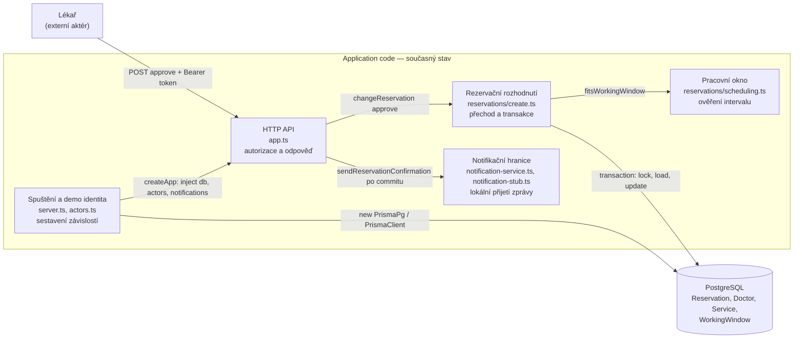

> ADR-001 až ADR-005 jsou historický podklad C01/CP1. Aktuální chování určuje [baseline C02 v0.2](c02/v02.md); na konci dokumentu následuje ověřený AS-IS pohled C03.

# Architektura a rozhodnutí

## ADR-001 — Stack a rozdělení projektu
Použijeme TypeScript, Express, Prisma, PostgreSQL, Vite, React a shadcn/ui.
Jde o volbu týmu místo doporučeného Java/Spring stacku: jeden jazyk na obou stranách,
typovaný přístup k datům a relační integrita. Tým si sám zajišťuje podporu, migrace a aktualizace.

Jeden repozitář s npm workspaces: `apps/api` vlastní data a API, `apps/web` vlastní UI.
Frontend neimportuje Prisma klienta a nepřistupuje přímo do DB. C01 UI je pouze statický základ.

## ADR-002 — Persistence spike A
Ověříme uložení a načtení Reservation přes skutečný PostgreSQL. Použijeme Prisma migraci,
nikoli `db push`; generovaný klient nebude verzovaný. Test poběží proti samostatné testovací DB.
Repository má jen create/findById; C01 business operace nevystavoval. CP1 přidává HTTP use case nad transakčním repository.
Výsledek experimentu a navazující rozhodnutí patří do evidence-and-evolution.md.

## ADR-003 — Čas a souběh (návrh pro CP1)
Reservation uchovává startsAt/endsAt v timestamptz; interval je [start, end).
Služba určuje délku pouze při vytvoření. Resource pro konflikt je Doctor.
CP1 používá PostgreSQL exclusion constraint přes doctorId a tstzrange(startsAt, endsAt, '[)')
s podmínkou status = CONFIRMED a rozšířením btree_gist, aby nešlo potvrdit konflikt souběžně.
V transakci probíhá validace a zápis; porušení pojmenovaného constraintu reservation_no_overlap se převádí na HTTP 409.
Ověřená Prisma 7.10 + pg cesta vrací P2039. Jiné DB chyby se nesmí maskovat jako kolize.
Samostatný SELECT a INSERT bez DB ochrany není dostatečný.
C01 ověřuje pouze persistence round-trip, nikoli souběžné potvrzování.

## ADR-004 — Notification Service (návrh hranice)
Typový port odděluje rezervaci od poskytovatele e-mailu. Volá se až po DB commitu.
Chyba notifikace nesmí zrušit potvrzení; před produkčním provozem je nutné řešit trvalou evidenci
neodeslaných zpráv, opakování a idempotenci. CP1 poskytuje pouze lokální logovací stub, nikoli poskytovatele nebo odesílání e-mailů.

## Rozsah C01 a odložená implementace
C01: dokumentace domény, sestavitelný skeleton, databázová migrace a skutečný persistence test.
CP1 nyní: create/confirm cesta, pracovní okna, kontrola dostupnosti konkrétního požadovaného intervalu, ochrana překryvu a automatizovaný end-to-end check.
Samostatný endpoint pro seznam dostupných začátků přijde v dalším PR společně s formulářem.
Další týdny: kompletní UI, autentizace, rušení s 24h pravidlem a skutečné e-maily.
Future pressure (výjimky z pracovních oken) je samostatně definována, nyní se neimplementuje.

## Stav závislostí při C01
Zvolena stabilní Prisma 7.10.0; `latest` na npm v době instalace ukazoval Prisma 8 release candidate.
Dne 15. 9. 2026 `npm audit` hlásil 4 high položky v řetězci Prisma CLI:
`deepmerge-ts@7.1.5`, `mysql2@3.15.3` a jejich nadřazené balíčky.
Stejný počet vrátil i `npm audit --omit=dev`; netvrdíme proto čistý production audit.

- [DeepmergeTS — rekurzivní grafy](https://github.com/advisories/GHSA-ggr8-5vv4-36mx)
- [mysql2 — autentizační downgrade](https://github.com/advisories/GHSA-3f6p-5ww8-9rcr)
- [mysql2 — dekomprese protokolu](https://github.com/advisories/GHSA-rgwj-5xj2-c3m3)

`npm ls deepmerge-ts mysql2` je zařadil pod Prisma CLI. C01 používá lokální PostgreSQL
s pg adaptérem a vlastní statickou Prisma konfiguraci; MySQL konektor nepoužívá.
Automatický návrh `npm audit fix --force` je downgrade Prisma na 6.19.3, který by vyžadoval
změnu konfigurace projektu. V C01 neprovádíme neověřený major override tranzitivní knihovny
ani tento downgrade. Před dalším nasazením tým znovu ověří opravenou stabilní Prisma verzi.

## ADR-005 — CP1 časová validace a transakce
Každá rezervace začíná na celé minutě, na 15min mřížce relativní k začátku pracovního okna.
Pracovní okna mají celominutové hranice. Validace rozdělí interval na nejvýše 1440 přesných
minutových úseků a ověří, že každý leží ve stejném místním dni a pracovním okně Europe/Prague.
Nejde o přibližné vzorkování: vstup i všechny hranice v této doméně mají minutovou přesnost.
Tím zachytí i návrat hodin, kdy začátek a konec mohou být uvnitř okna, ale část intervalu mimo něj.
Délka služby je skutečně uplynulý čas; používáme Intl a nezávisíme na časové zóně hostitele.

DB transakce validuje reference a pracovní okna a uloží CONFIRMED. Jeden transakční connection
čte reference sekvenčně; souběžné HTTP požadavky si DB vyřeší přes exclusion constraint.
Pracovní dobu/služby CP1 ještě neumí upravovat přes API; při zavedení těchto operací bude nutné
řešit jejich souběh s potvrzováním rezervací. Záměrně nyní neposkytujeme idempotentní retry POST.

Zdroje rozhodnutí: [PostgreSQL range constraints](https://www.postgresql.org/docs/17/rangetypes.html#RANGETYPES-CONSTRAINT),
[Prisma custom check constraints](https://docs.prisma.io/docs/orm/v6/more/troubleshooting/check-constraints).

## C03, část A — AS-IS průchod schválením rezervace

Tato část zachycuje skutečnou realizaci na `master` po C02 (merge PR #7). Je to popis současného stavu, nikoli návrh cílové architektury. Sledujeme již vytvořenou a stále platnou `PENDING_APPROVAL` pro lékaře, který vyžaduje schválení.

### A1. Sledovaný scénář

| Položka | Hodnota |
| --- | --- |
| Scénář / operace | [C02 OP-05 — Approve Reservation](c02/v02.md), hlavní úspěšný scénář v řádcích 58–71 |
| Požadavky | REQ-08 (vlastní lékař a platný interval), REQ-04 (nejvýše jedna kolidující alokace), REQ-09 (kolizní žádost zůstane čekající) |
| Pravidla / invarianty | BR-02 výlučnost, BR-04 pracovní okno, BR-05 oprávnění a stav, BR-06 pořadí a souběh, BR-07 notifikace, BR-08 deadline; [centrální pravidla v0.2](c02/v02.md) |
| Baseline | Specification Baseline v0.2, tag `c02-v0.2` jako historický snapshot; aktuální integrace obsahuje i review opravy z PR #5/#7 |

### A2. Hlavní průchod: scénář → konkrétní kód

| Business krok z OP-05 | Skutečná realizace | Doklad |
| --- | --- | --- |
| Lékař požádá o schválení a systém určí jeho identitu | `POST /reservations/:id/approve` je jednou z tras vytvořených v `createApp`; `actor(req)` hledá bearer token v serverem připravené mapě. Tělo musí být prázdné, ID musí být UUID. | [app.ts, `actor` a trasa](../apps/api/src/app.ts#L21-L49); [actors.ts, demo mapa](../apps/api/src/actors.ts#L6-L12) |
| Serializovaně načíst rezervaci a rozhodný čas | `changeReservation` otevře Prisma transakci. `lockedReservation` vykoná `SELECT ... FOR UPDATE`, potom `findUnique`. `now()` se volá až po zámku. | [create.ts, zámek a transakce](../apps/api/src/reservations/create.ts#L38-L68); [test čekání na zámek](../apps/api/tests/reservation-http.integration.test.ts#L258-L285) |
| Ověřit oprávnění, platnost a povolený zdrojový stav | Pro `approve` se porovná role a ID lékaře s `row.doctorId`; `hasExpired` zkoumá uložený deadline, poté je požadován `PENDING_APPROVAL`. | [create.ts, rozhodnutí](../apps/api/src/reservations/create.ts#L44-L82); [test cizího lékaře a pacienta](../apps/api/tests/reservation-http.integration.test.ts#L178-L187) |
| Znovu ověřit existující službu, lékaře, budoucí začátek a celé pracovní okno | `interval` načte lékaře s okny i službu. Dostane uložený `row.endsAt`, takže změna délky služby neposune rezervaci. `fitsWorkingWindow` ověří všechny minutové části v čase Europe/Prague. | [create.ts, `interval` a volání při Approve](../apps/api/src/reservations/create.ts#L9-L19), [create.ts, kontrola před zápisem](../apps/api/src/reservations/create.ts#L86-L87), [scheduling.ts](../apps/api/src/reservations/scheduling.ts#L3-L30), [test změny služby a oken](../apps/api/tests/reservation-http.integration.test.ts#L245-L252) |
| Přidělit kapacitu bez dvojího obsazení a uložit `CONFIRMED` | `tx.reservation.update` mění stav ve stejné transakci. Unikátní ochrana kolize je PostgreSQL exclusion constraint `reservation_no_overlap` pro stejného lékaře a překryv intervalů se stavem `CONFIRMED`; žádná předběžná kontrola dostupnosti při Approve neprobíhá. | [create.ts, zápis](../apps/api/src/reservations/create.ts#L95-L99), [SQL migrace, constraint](../apps/api/prisma/migrations/20260915132500_reservation_constraints/migration.sql#L12-L16), [test souběžných schválení](../apps/api/tests/reservation-http.integration.test.ts#L189-L196) |
| Po commitu požádat o potvrzovací zprávu a odpovědět | `changeReservation` vrátí potvrzovací data až po úspěchu transakce; trasa volá `notifications.sendReservationConfirmation`, zachytí její chybu a vrací 200 se stavem. Lokální adaptér pouze loguje přijetí, skutečný email neodesílá. | [create.ts, výsledek transakce](../apps/api/src/reservations/create.ts#L95-L101), [app.ts, post-commit volání a odpověď](../apps/api/src/app.ts#L43-L48), [notification-stub.ts](../apps/api/src/notifications/notification-stub.ts#L3-L7), [živá C02 ukázka](evidence/c02-v02-demo.txt#L10-L15) |

Tady není samostatný controller ani `ReservationService` třída: HTTP obsluha je funkce v `app.ts`, rozhodovací logika je v `create.ts`. Obecné [repository.ts](../apps/api/src/reservations/repository.ts) používá starší persistence spike; tato operace volá Prisma přímo v transakci.

### A3. Důležitá alternativa: jiné schválení už obsadilo tentýž čas

Platí pro dvě **nevypršelé** `PENDING_APPROVAL` stejného lékaře s překryvem. Druhá žádost smí dál čekat, ale nemůže se stát `CONFIRMED`.

| Co říká v0.2 | Kde se podmínka zjistí | Kde se rozhodne výsledek | Co dostane volající |
| --- | --- | --- | --- |
| BR-02, REQ-04/09: nejvýše jedna potvrzená rezervace; konfliktní žádost zůstane čekající | PostgreSQL `reservation_no_overlap` při `tx.reservation.update(status: CONFIRMED)` v [create.ts](../apps/api/src/reservations/create.ts#L95-L96); definice [SQL](../apps/api/prisma/migrations/20260915132500_reservation_constraints/migration.sql#L12-L16) | Po DB odmítnutí se transakce vrátí zpět; `catch` překládá pouze Prisma `P2039` se jménem constraintu na `RESERVATION_CONFLICT` v [create.ts](../apps/api/src/reservations/create.ts#L102-L105) | Error handler vrátí **HTTP 409** s kódem `RESERVATION_CONFLICT` podle [app.ts](../apps/api/src/app.ts#L51-L56). Řádek zůstane `PENDING_APPROVAL`, bez potvrzovací notifikace. |

[Integrační test](../apps/api/tests/reservation-http.integration.test.ts#L189-L196) ověřuje dvě současná schválení: jedno 200/`CONFIRMED`, druhé 409/`PENDING_APPROVAL`, jedna notifikace. [Živá HTTP ukázka](evidence/c02-v02-demo.txt#L16-L20) ukazuje totéž pořadově. **Rozdíl proti v0.2 v této větvi nenalezen**; kolizi rozhoduje databáze při zápisu, což odpovídá požadovanému výsledku, i když to specifikace jako techniku nepředepisuje.

### A4. Hlavní části současné realizace

V tabulce jsou logické skupiny modulů na stejné úrovni; obsah každé skupiny je uveden konkrétně. Nejde o nové navržené vrstvy.

| Část implementace | Typ / obsah | Role v tomto scénáři | Doklad |
| --- | --- | --- | --- |
| Spuštění a demo identita | moduly `server.ts`, `actors.ts` | Sestaví Prisma klienta, notifikační stub a mapu token → role/ID; předá je API. | [server.ts](../apps/api/src/server.ts#L1-L13), [actors.ts](../apps/api/src/actors.ts#L2-L12) |
| HTTP API | modul `app.ts` | Přijme Approve, ověří token a tvar vstupu, zavolá změnu stavu, po commitu požádá notifikaci a vrátí HTTP výsledek. | [app.ts](../apps/api/src/app.ts#L21-L56) |
| Rezervační rozhodnutí a přímé DB volání | modul `reservations/create.ts` | Zamkne řádek, posoudí pravidla, v transakci zapíše `CONFIRMED`, přeloží konflikt. | [create.ts](../apps/api/src/reservations/create.ts#L38-L107) |
| Výpočet pracovního okna | modul `reservations/scheduling.ts` | Ověří celý uložený interval v Europe/Prague, včetně hranic a změn času. | [scheduling.ts](../apps/api/src/reservations/scheduling.ts#L3-L30) |
| Notifikační hranice | typový port `notification-service.ts` a lokální modul `notification-stub.ts` | Přijme po commitu požadavek na potvrzení; stub loguje ID, neposílá email. | [port](../apps/api/src/notifications/notification-service.ts#L2-L14), [stub](../apps/api/src/notifications/notification-stub.ts#L3-L7) |

### A5. Stav, přechod a BR-02

**Stav a změna stavu**

| Otázka | Odpověď | Doklad |
| --- | --- | --- |
| Kde je stav trvale uložen? | V PostgreSQL tabulce `Reservation`, sloupec `status`; `approvalRequestedAt` a `approvalExpiresAt` jsou uložené ve stejném řádku. Prisma model je mapuje na `ReservationStatus` a `DateTime?`. | [schema.prisma](../apps/api/prisma/schema.prisma#L57-L70), [migrace approval polí](../apps/api/prisma/migrations/20260922120000_approval_lifecycle/migration.sql) |
| Který kód rozhoduje/provádí přechod? | `changeReservation` nejdříve autorizuje a zkoumá `PENDING_APPROVAL`/deadline/okno, potom `tx.reservation.update` zapisuje `CONFIRMED`. `app.ts` pouze vybere operaci a odešle výsledek. | [create.ts](../apps/api/src/reservations/create.ts#L62-L99), [app.ts](../apps/api/src/app.ts#L40-L49) |

**BR-02 — výlučný lékař, nepřekryv potvrzených rezervací**

| Otázka | Odpověď | Doklad |
| --- | --- | --- |
| Kde se zjistí podmínka pravidla? | Až v PostgreSQL při zápisu `CONFIRMED`: partial GiST exclusion constraint porovná `doctorId` a překryv půlotevřených `tstzrange`; čekající žádosti z podmínky vynechá. | [SQL migrace](../apps/api/prisma/migrations/20260915132500_reservation_constraints/migration.sql#L12-L16) |
| Kde se podle výsledku rozhodne? | DB zápis uspěje nebo vrátí chybu. `changeReservation` podle `P2039` a jména constraintu vybere doménový konflikt 409; jiné chyby nepřeznačí. | [create.ts](../apps/api/src/reservations/create.ts#L95-L105) |
| Kde se provede výsledná změna? | `tx.reservation.update(status: CONFIRMED)` v transakci; při konfliktu rollback ponechá původní `PENDING_APPROVAL`. | [create.ts](../apps/api/src/reservations/create.ts#L95-L99), [souběžný test](../apps/api/tests/reservation-http.integration.test.ts#L189-L196) |

### A6. Skutečně zapojené závislosti

| Závislost | Kde se napojuje | Kdo zná technické API | Doklad |
| --- | --- | --- | --- |
| PostgreSQL 17 přes Prisma 7 a `@prisma/adapter-pg` | `server.ts` vytvoří `PrismaPg` a `PrismaClient`; `createApp` předá klienta do `changeReservation`. | `server.ts` zná adapter; `reservations/create.ts` zná Prisma `$transaction`, raw SQL lock, ORM dotazy a chybu `P2039`. Exclusion constraint žije v SQL migraci. | [server.ts](../apps/api/src/server.ts#L2-L10), [create.ts](../apps/api/src/reservations/create.ts#L38-L105), [SQL](../apps/api/prisma/migrations/20260915132500_reservation_constraints/migration.sql#L12-L16) |
| Systémový čas | Výchozí `now = () => new Date()` v `createApp`, předán do `changeReservation`; čas se čte po zámku. | `app.ts` a `create.ts`; v testech je hodina injektovaná. | [app.ts](../apps/api/src/app.ts#L9-L21), [create.ts](../apps/api/src/reservations/create.ts#L62-L68), [test hranice při zámku](../apps/api/tests/reservation-http.integration.test.ts#L258-L285) |
| Demo identita; **žádný externí IdP** | `demoActors()` mapuje dva tokeny z prostředí na pevná ID; `app.ts` token hledá v mapě. | `actors.ts` zná prostředí, `app.ts` zná bearer hlavičku a mapu. | [actors.ts](../apps/api/src/actors.ts#L6-L12), [app.ts](../apps/api/src/app.ts#L21-L27) |
| Notifikační port; **žádný externí emailový systém** | `server.ts` injektuje `createNotificationStub`; `app.ts` po commitu volá port. | `app.ts` zná rozhraní `NotificationService`; `notification-stub.ts` implementuje lokální logování. | [server.ts](../apps/api/src/server.ts#L5-L10), [app.ts](../apps/api/src/app.ts#L43-L47), [stub](../apps/api/src/notifications/notification-stub.ts#L3-L7) |

### A7. AS-IS strukturální pohled

Všechny bloky uvnitř Application code jsou **skupiny modulů**, jejich konkrétní soubory jsou uvedeny přímo v blocích a tabulce A4. Databáze je mimo aplikační kód. V diagramu není externí emailový provider ani IdP, protože aplikace je nepoužívá. Vazba k DB z rozhodovacího modulu vede přes předaný generovaný Prisma klient; [repository.ts](../apps/api/src/reservations/repository.ts) se v tomto scénáři nevolá. Notifikační port je typový kontrakt, runtime cíl je lokální stub.

### A8. Jedna otázka pro další architektonický návrh

| Položka | Obsah |
| --- | --- |
| Otázka | Jak zaznamenat požadavek na potvrzovací zprávu trvale společně s přechodem do `CONFIRMED`, pokud má budoucí reálné odesílání přežít pád procesu mezi DB commitem a notifikačním voláním? |
| Doklad | [create.ts](../apps/api/src/reservations/create.ts#L95-L101) dokončí transakci před návratem; [app.ts](../apps/api/src/app.ts#L43-L48) volá notifikaci až poté a při chybě jen zaloguje; [stub](../apps/api/src/notifications/notification-stub.ts#L3-L7) nic neposílá. C02 BR-07 garantuje pořadí a zachování stavu, nikoli skutečné doručení. |
| Proč je důležitá | Současné oddělení chrání rezervaci před chybou notifikace, ale po pádu mezi těmito kroky se může ztratit informace, že zpráva měla být odeslána. Tato otázka určuje hranici transakce a spolehlivost budoucí notifikační integrace v další části C03. |

**Kontrola proti baseline:** U sledovaného úspěchu a kolizní větve nebyl zjištěn rozpor mezi [v0.2 OP-05](c02/v02.md) a současným kódem. Oprávnění, stav, deadline, pracovní okno a souběh jsou doloženy výše uvedenými integračními testy. Tato část netvrdí, že v C03 už existuje cílová architektura nebo reálná emailová integrace.
