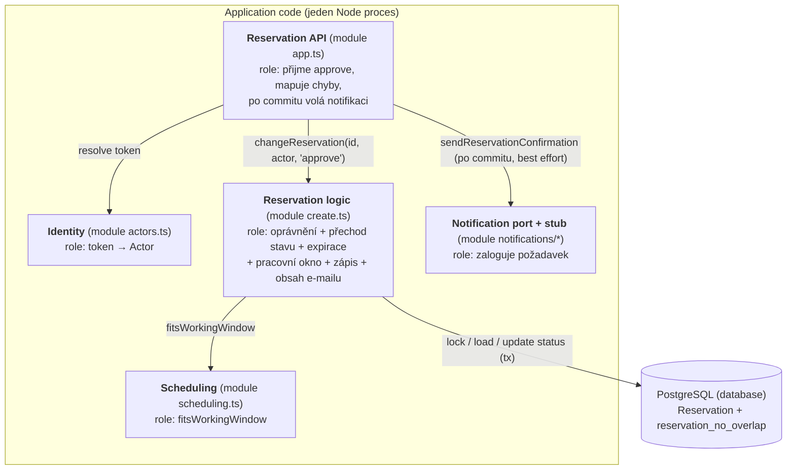

> Historický podklad C01/CP1 (ADR-001 až ADR-005). Aktuální chování určuje [baseline v0.2](c02/v02.md); C03 přidává AS-IS mapování (Část A níže), ADR-006/007 a [TO-BE architekturu](c03/architecture.md).

# Architektura a rozhodnutí

## ADR-001 — Stack a rozdělení projektu
Použijeme TypeScript, Express, Prisma, PostgreSQL, Vite, React a shadcn/ui.
Jde o volbu týmu místo doporučeného Java/Spring stacku: jeden jazyk na obou stranách,
typovaný přístup k datům a relační integrita. Tým si sám zajišťuje podporu, migrace a aktualizace.

Jeden repozitář s npm workspaces: `apps/api` vlastní data a API, `apps/web` vlastní UI.
Frontend neimportuje Prisma klienta a nepřistupuje přímo do DB. C01 UI je pouze statický základ.

## ADR-002 — Persistence spike A
Ověříme uložení a načtení Reservation přes skutečný PostgreSQL. Použijeme Prisma migraci,
nikoli `db push`; generovaný klient nebude verzovaný. Test poběží proti samostatné testovací DB.
Repository má jen create/findById; C01 business operace nevystavoval. CP1 přidává HTTP use case nad transakčním repository.
Výsledek experimentu a navazující rozhodnutí patří do evidence-and-evolution.md.

## ADR-003 — Čas a souběh (návrh pro CP1)
Reservation uchovává startsAt/endsAt v timestamptz; interval je [start, end).
Služba určuje délku pouze při vytvoření. Resource pro konflikt je Doctor.
CP1 používá PostgreSQL exclusion constraint přes doctorId a tstzrange(startsAt, endsAt, '[)')
s podmínkou status = CONFIRMED a rozšířením btree_gist, aby nešlo potvrdit konflikt souběžně.
V transakci probíhá validace a zápis; porušení pojmenovaného constraintu reservation_no_overlap se převádí na HTTP 409.
Ověřená Prisma 7.10 + pg cesta vrací P2039. Jiné DB chyby se nesmí maskovat jako kolize.
Samostatný SELECT a INSERT bez DB ochrany není dostatečný.
C01 ověřuje pouze persistence round-trip, nikoli souběžné potvrzování.

## ADR-004 — Notification Service (návrh hranice)
Typový port odděluje rezervaci od poskytovatele e-mailu. Volá se až po DB commitu.
Chyba notifikace nesmí zrušit potvrzení; před produkčním provozem je nutné řešit trvalou evidenci
neodeslaných zpráv, opakování a idempotenci. CP1 poskytuje pouze lokální logovací stub, nikoli poskytovatele nebo odesílání e-mailů.

## Rozsah C01 a odložená implementace
C01: dokumentace domény, sestavitelný skeleton, databázová migrace a skutečný persistence test.
CP1 nyní: create/confirm cesta, pracovní okna, kontrola dostupnosti konkrétního požadovaného intervalu, ochrana překryvu a automatizovaný end-to-end check.
Samostatný endpoint pro seznam dostupných začátků přijde v dalším PR společně s formulářem.
Další týdny: kompletní UI, autentizace, rušení s 24h pravidlem a skutečné e-maily.
Future pressure (výjimky z pracovních oken) je samostatně definována, nyní se neimplementuje.

## Stav závislostí při C01
Zvolena stabilní Prisma 7.10.0; `latest` na npm v době instalace ukazoval Prisma 8 release candidate.
Dne 15. 9. 2026 `npm audit` hlásil 4 high položky v řetězci Prisma CLI:
`deepmerge-ts@7.1.5`, `mysql2@3.15.3` a jejich nadřazené balíčky.
Stejný počet vrátil i `npm audit --omit=dev`; netvrdíme proto čistý production audit.

- [DeepmergeTS — rekurzivní grafy](https://github.com/advisories/GHSA-ggr8-5vv4-36mx)
- [mysql2 — autentizační downgrade](https://github.com/advisories/GHSA-3f6p-5ww8-9rcr)
- [mysql2 — dekomprese protokolu](https://github.com/advisories/GHSA-rgwj-5xj2-c3m3)

`npm ls deepmerge-ts mysql2` je zařadil pod Prisma CLI. C01 používá lokální PostgreSQL
s pg adaptérem a vlastní statickou Prisma konfiguraci; MySQL konektor nepoužívá.
Automatický návrh `npm audit fix --force` je downgrade Prisma na 6.19.3, který by vyžadoval
změnu konfigurace projektu. V C01 neprovádíme neověřený major override tranzitivní knihovny
ani tento downgrade. Před dalším nasazením tým znovu ověří opravenou stabilní Prisma verzi.

## ADR-005 — CP1 časová validace a transakce
Každá rezervace začíná na celé minutě, na 15min mřížce relativní k začátku pracovního okna.
Pracovní okna mají celominutové hranice. Validace rozdělí interval na nejvýše 1440 přesných
minutových úseků a ověří, že každý leží ve stejném místním dni a pracovním okně Europe/Prague.
Nejde o přibližné vzorkování: vstup i všechny hranice v této doméně mají minutovou přesnost.
Tím zachytí i návrat hodin, kdy začátek a konec mohou být uvnitř okna, ale část intervalu mimo něj.
Délka služby je skutečně uplynulý čas; používáme Intl a nezávisíme na časové zóně hostitele.

DB transakce validuje reference a pracovní okna a uloží CONFIRMED. Jeden transakční connection
čte reference sekvenčně; souběžné HTTP požadavky si DB vyřeší přes exclusion constraint.
Pracovní dobu/služby CP1 ještě neumí upravovat přes API; při zavedení těchto operací bude nutné
řešit jejich souběh s potvrzováním rezervací. Záměrně nyní neposkytujeme idempotentní retry POST.

Zdroje rozhodnutí: [PostgreSQL range constraints](https://www.postgresql.org/docs/17/rangetypes.html#RANGETYPES-CONSTRAINT),
[Prisma custom check constraints](https://docs.prisma.io/docs/orm/v6/more/troubleshooting/check-constraints).

---

# C03 Část A — AS-IS realizace scénáře Approve Reservation

Stav kódu: commit `b44c2e2` (master po C02, tag `c02-v0.2`). Všechna tvrzení níže jsou ověřena v kódu nebo testem
`npm test` (63/63 zelených před změnou C03, viz [evidence](evidence-and-evolution.md#c03--architecture-evidence)).

## A1. Sledovaný scénář

| Položka | Hodnota |
|---|---|
| Scénář / operace | Confirm Reservation u lékaře s `requiresApproval` → odložené **Approve Reservation** (OP-03 + OP-05) včetně potvrzovací notifikace |
| Požadavky | REQ-03, REQ-04, REQ-07, REQ-08, REQ-09 |
| Pravidla / invarianty | BR-02 (exkluzivita), BR-05 (stav a oprávnění), BR-06 (čas a souběh), BR-07 (notifikace), BR-08 (platnost žádosti) |
| Baseline | [v0.2](c02/v02.md) |

## A2. Hlavní průchod scénáře v kódu

| Krok scénáře z C02 (OP-05) | Realizace v kódu | Doklad |
|---|---|---|
| přijmout požadavek na schválení | Express route `POST /reservations/:id/approve` (smyčka přes 4 operace) | `apps/api/src/app.ts:40-49` |
| ověřit identitu lékaře | `actor(req)` mapuje Bearer token na `Actor` z demo mapy | `app.ts:23-28`, `actors.ts:7-13` |
| serializovaně načíst Reservation | `lockedReservation()` — `SELECT … FOR UPDATE` uvnitř `db.$transaction` | `reservations/create.ts:38-43, 62-63` |
| ověřit oprávnění (BR-05) | inline podmínka „role doctor a `actor.id === row.doctorId`“ | `create.ts:64-66` |
| vzorkovat čas po zámku, ověřit platnost (BR-08) | `const time = now()` až po zámku, `hasExpired(row, time)` | `create.ts:67-72, 44-48` |
| ověřit, že přechod je povolený | `requiredState = … "PENDING_APPROVAL"`, jinak 409 `INVALID_STATE` | `create.ts:81-82` |
| ověřit pracovní okno (BR-04) | `interval()` načte lékaře, službu a okna, `fitsWorkingWindow()` | `create.ts:9-18, 86-87`, `scheduling.ts` |
| vyhodnotit konflikt (BR-02) a změnit stav | `tx.reservation.update({ status: "CONFIRMED" })`; konflikt rozhodne DB constraint `reservation_no_overlap` | `create.ts:96`, migrace `20260915132500_reservation_constraints/migration.sql:12` |
| uložit výsledek | commit interaktivní Prisma transakce | `create.ts:61-101` |
| sestavit obsah notifikace | `changeReservation` načte e-mail pacienta a vrátí objekt `confirmation` | `create.ts:95-98` |
| po commitu poslat notifikaci (BR-07) | **HTTP handler** volá `notifications.sendReservationConfirmation()` a chybu jen zaloguje | `app.ts:43-46` |

Předchozí krok Confirm (DRAFT → PENDING_APPROVAL) prochází stejnou funkcí `changeReservation`, větev `create.ts:88-93`.

## A3. Alternativní větev — kolize při schválení

| Co říká v0.2 | Kde se podmínka zjistí | Kde se rozhodne výsledek | Co dostane volající |
|---|---|---|---|
| OP-05: překryv s CONFIRMED → 409, žádost zůstane PENDING_APPROVAL (REQ-09) | PostgreSQL exclusion constraint `reservation_no_overlap` při `UPDATE … status = CONFIRMED` | catch v `changeReservation`: Prisma `P2039` + název constraintu → `ReservationError(409, "RESERVATION_CONFLICT")`; rollback zachová PENDING_APPROVAL | `409 {"error":{"code":"RESERVATION_CONFLICT"}}` (`app.ts:51-55`) |

Ověřeno testem `REQ-09: concurrent conflicting approvals confirm one and preserve the other request`.

Rozdíl specifikace ↔ implementace v pozorovatelném chování **nebyl nalezen**. Nalezen byl architektonický rozdíl vůči ADR-004:

| Specifikace / rozhodnutí | Implementace | Doklad |
|---|---|---|
| BR-07: chyba notifikace nemění výsledek; ADR-004: „před produkčním provozem nutná trvalá evidence neodeslaných zpráv, opakování a idempotence“ | Notifikace se posílá z HTTP vrstvy až po commitu, chyba se jen zaloguje. Pád procesu mezi commitem a odesláním nebo výpadek poskytovatele zprávu **bez stopy ztratí**; retry neexistuje | `app.ts:43-46` |

## A4. Hlavní části implementace

| Část implementace | Typ / obsah | Role v tomto scénáři | Doklad |
|---|---|---|---|
| Reservation API | modul `app.ts` (Express routes, `actor()`, error handler) | přijme command, ověří identitu, **pošle notifikaci** | `app.ts` |
| Identity | modul `actors.ts` (`demoActors`, `requirePatient`) | token → Actor | `actors.ts` |
| Reservation logic | modul `reservations/create.ts` (`changeReservation`, `lockedReservation`, `hasExpired`, `interval`) | oprávnění, přechod stavu, platnost žádosti, pracovní okno, zápis, obsah notifikace — vše v jedné funkci | `create.ts:59-107` |
| Scheduling | modul `reservations/scheduling.ts` (`fitsWorkingWindow`) | čistá validace BR-04 | `scheduling.ts` |
| Notification port | `notifications/notification-service.ts` + `notification-stub.ts` | rozhraní a logovací stub | `notifications/*` |
| Persistence | Prisma client + PostgreSQL schéma a constraint | uložení stavu, autoritativní BR-02 | `prisma/schema.prisma`, migrace |

## A5. Stav, změna stavu a pravidlo

**Stav**

| Otázka | Odpověď | Doklad |
|---|---|---|
| Kde je stav Reservation trvale uložen? | PostgreSQL tabulka `Reservation`, sloupec `status` (enum `ReservationStatus`) + `approvalRequestedAt`, `approvalExpiresAt` | `schema.prisma`, migrace `20260922120000_approval_lifecycle` |
| Který kód rozhoduje/provádí přechod? | `changeReservation` v `create.ts`; status literály se zapisují na **šesti místech** (`create.ts:28, 56, 69, 79, 84, 89-96`) a `readReservation` má vlastní kopii expirace | `create.ts` |

**Pravidlo BR-02**

| Otázka | Odpověď | Doklad |
|---|---|---|
| Kde se zjistí podmínka? | DB constraint `reservation_no_overlap` (`EXCLUDE USING gist … WHERE status = 'CONFIRMED'`); informativně i v `checkAvailability` (`create.ts:33-34`) | migrace `…_reservation_constraints` |
| Kde se podle výsledku rozhodne? | catch v `changeReservation` mapuje `P2039` na 409 | `create.ts:102-105` |
| Kde se provede změna stavu? | `tx.reservation.update` v téže transakci (rollback při kolizi) | `create.ts:96` |

Pravidlo, **které stavy blokují**, je zapsané dvakrát: v DB constraintu a v `checkAvailability` (`status: "CONFIRMED"`).

## A6. Závislosti

| Závislost | Kde se napojuje | Která část zná technické API | Doklad |
|---|---|---|---|
| PostgreSQL 17 | Prisma client předaný do `createApp` | `create.ts` (Prisma API, raw `FOR UPDATE`, kód chyby `P2039`) | `server.ts:7-9` |
| Notification Service | port `NotificationService` předaný do `createApp` | **`app.ts`** (volá ho HTTP handler); implementace je jen stub | `app.ts:43-46`, `server.ts:10` |
| IdP | neexistuje — demo tokeny z `.env` | `actors.ts` | `actors.ts:7-13` |

## A7. AS-IS strukturální diagram

Bloky: Reservation API = `app.ts`; Identity = `actors.ts`; Reservation logic = `create.ts` (`changeReservation`,
`readReservation`, `lockedReservation`, `hasExpired`, `interval`); Scheduling = `scheduling.ts`;
Notification port = `notification-service.ts`, `notification-stub.ts`.

## A8. Otázka pro C03

| Položka | Obsah |
|---|---|
| Otázka | Kde a jak má být zajištěno doručení potvrzovací notifikace, aby její selhání nezměnilo výsledek Confirm/Approve a požadavek se neztratil? |
| Doklad | `app.ts:43-46`: HTTP handler volá poskytovatele až po commitu a chybu pouze zaloguje; mezi commitem a odesláním neexistuje trvalý záznam |
| Proč je důležitá | BR-07 a ADR-004; odložené schválení (BR-08) znamená, že potvrzení přichází v jiném requestu než žádost pacienta — e-mail je jediný kanál, kterým se pacient o CONFIRMED dozví |

Vedlejší nález pro C03: rozhodování o přechodech stavu je roztroušené v `changeReservation`/`readReservation` a promíchané s I/O
(šest zápisů status literálů, duplicitní expirace), takže statechart v0.2 nemá v kódu jednoho vlastníka.
