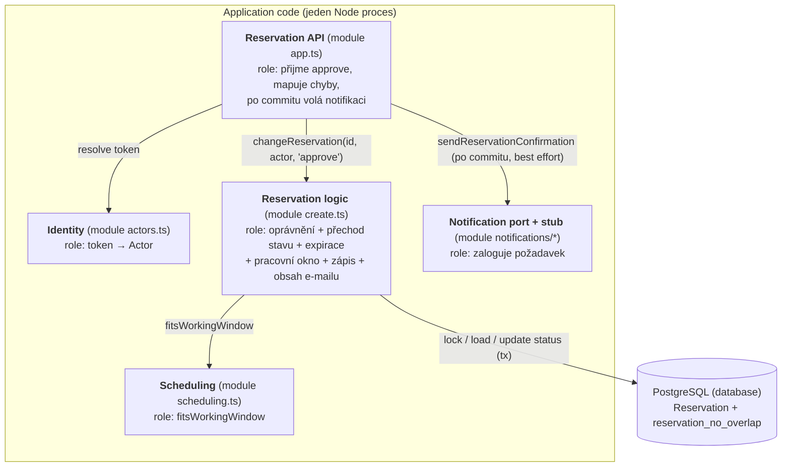
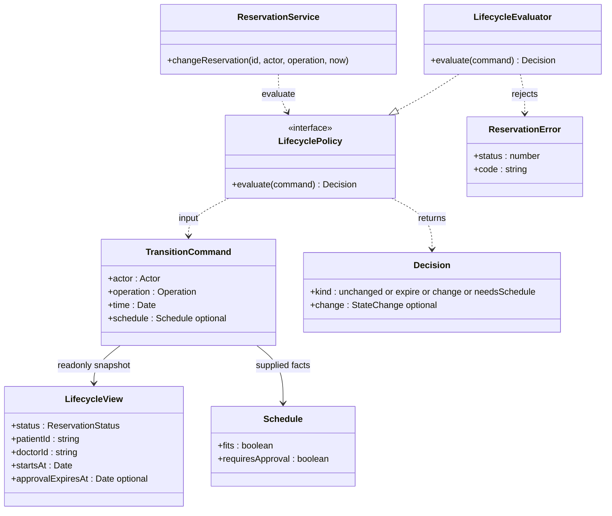
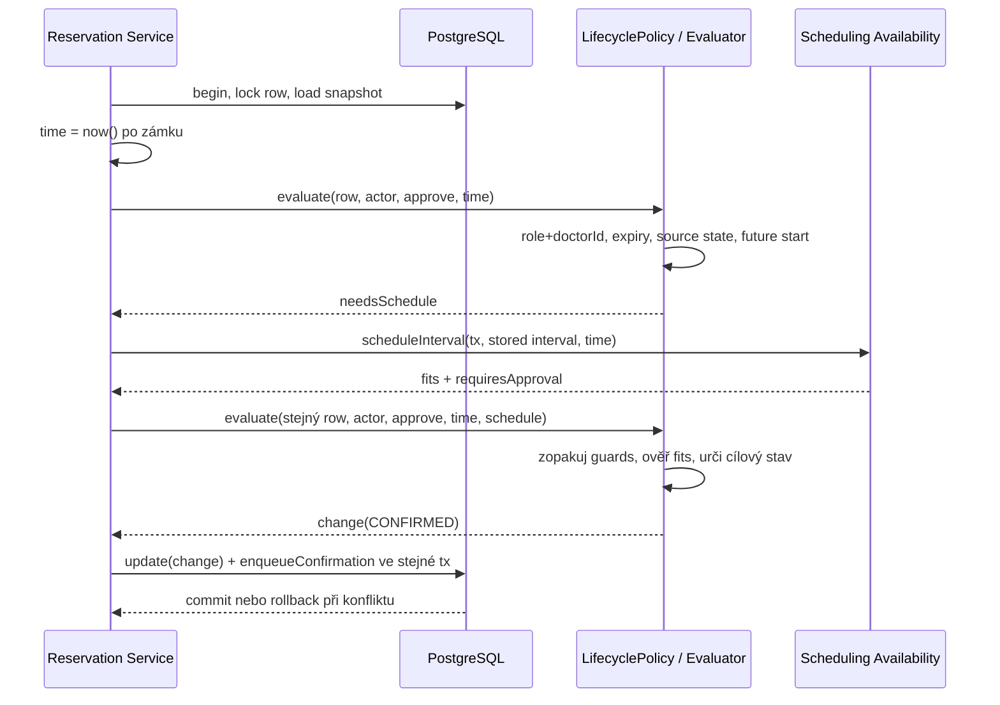

> Historický podklad C01/CP1 (ADR-001 až ADR-005). Aktuální chování určuje [baseline v0.2](c02/v02.md); C03 přidává AS-IS mapování (Část A níže), ADR-006/007 a [TO-BE architekturu](c03/architecture.md).

# Architektura a rozhodnutí

## ADR-001 — Stack a rozdělení projektu
Použijeme TypeScript, Express, Prisma, PostgreSQL, Vite, React a shadcn/ui.
Jde o volbu týmu místo doporučeného Java/Spring stacku: jeden jazyk na obou stranách,
typovaný přístup k datům a relační integrita. Tým si sám zajišťuje podporu, migrace a aktualizace.

Jeden repozitář s npm workspaces: `apps/api` vlastní data a API, `apps/web` vlastní UI.
Frontend neimportuje Prisma klienta a nepřistupuje přímo do DB. C01 UI je pouze statický základ.

## ADR-002 — Persistence spike A
Ověříme uložení a načtení Reservation přes skutečný PostgreSQL. Použijeme Prisma migraci,
nikoli `db push`; generovaný klient nebude verzovaný. Test poběží proti samostatné testovací DB.
Repository má jen create/findById; C01 business operace nevystavoval. CP1 přidává HTTP use case nad transakčním repository.
Výsledek experimentu a navazující rozhodnutí patří do evidence-and-evolution.md.

## ADR-003 — Čas a souběh (návrh pro CP1)
Reservation uchovává startsAt/endsAt v timestamptz; interval je [start, end).
Služba určuje délku pouze při vytvoření. Resource pro konflikt je Doctor.
CP1 používá PostgreSQL exclusion constraint přes doctorId a tstzrange(startsAt, endsAt, '[)')
s podmínkou status = CONFIRMED a rozšířením btree_gist, aby nešlo potvrdit konflikt souběžně.
V transakci probíhá validace a zápis; porušení pojmenovaného constraintu reservation_no_overlap se převádí na HTTP 409.
Ověřená Prisma 7.10 + pg cesta vrací P2039. Jiné DB chyby se nesmí maskovat jako kolize.
Samostatný SELECT a INSERT bez DB ochrany není dostatečný.
C01 ověřuje pouze persistence round-trip, nikoli souběžné potvrzování.

## ADR-004 — Notification Service (návrh hranice)
Typový port odděluje rezervaci od poskytovatele e-mailu. Volá se až po DB commitu.
Chyba notifikace nesmí zrušit potvrzení; před produkčním provozem je nutné řešit trvalou evidenci
neodeslaných zpráv, opakování a idempotenci. CP1 poskytuje pouze lokální logovací stub, nikoli poskytovatele nebo odesílání e-mailů.

## Rozsah C01 a odložená implementace
C01: dokumentace domény, sestavitelný skeleton, databázová migrace a skutečný persistence test.
CP1 nyní: create/confirm cesta, pracovní okna, kontrola dostupnosti konkrétního požadovaného intervalu, ochrana překryvu a automatizovaný end-to-end check.
Samostatný endpoint pro seznam dostupných začátků přijde v dalším PR společně s formulářem.
Další týdny: kompletní UI, autentizace, rušení s 24h pravidlem a skutečné e-maily.
Future pressure (výjimky z pracovních oken) je samostatně definována, nyní se neimplementuje.

## Stav závislostí při C01
Zvolena stabilní Prisma 7.10.0; `latest` na npm v době instalace ukazoval Prisma 8 release candidate.
Dne 15. 9. 2026 `npm audit` hlásil 4 high položky v řetězci Prisma CLI:
`deepmerge-ts@7.1.5`, `mysql2@3.15.3` a jejich nadřazené balíčky.
Stejný počet vrátil i `npm audit --omit=dev`; netvrdíme proto čistý production audit.

- [DeepmergeTS — rekurzivní grafy](https://github.com/advisories/GHSA-ggr8-5vv4-36mx)
- [mysql2 — autentizační downgrade](https://github.com/advisories/GHSA-3f6p-5ww8-9rcr)
- [mysql2 — dekomprese protokolu](https://github.com/advisories/GHSA-rgwj-5xj2-c3m3)

`npm ls deepmerge-ts mysql2` je zařadil pod Prisma CLI. C01 používá lokální PostgreSQL
s pg adaptérem a vlastní statickou Prisma konfiguraci; MySQL konektor nepoužívá.
Automatický návrh `npm audit fix --force` je downgrade Prisma na 6.19.3, který by vyžadoval
změnu konfigurace projektu. V C01 neprovádíme neověřený major override tranzitivní knihovny
ani tento downgrade. Před dalším nasazením tým znovu ověří opravenou stabilní Prisma verzi.


## ADR-005 — CP1 časová validace a transakce
Každá rezervace začíná na celé minutě, na 15min mřížce relativní k začátku pracovního okna.
Pracovní okna mají celominutové hranice. Validace rozdělí interval na nejvýše 1440 přesných
minutových úseků a ověří, že každý leží ve stejném místním dni a pracovním okně Europe/Prague.
Nejde o přibližné vzorkování: vstup i všechny hranice v této doméně mají minutovou přesnost.
Tím zachytí i návrat hodin, kdy začátek a konec mohou být uvnitř okna, ale část intervalu mimo něj.
Délka služby je skutečně uplynulý čas; používáme Intl a nezávisíme na časové zóně hostitele.

DB transakce validuje reference a pracovní okna a uloží CONFIRMED. Jeden transakční connection
čte reference sekvenčně; souběžné HTTP požadavky si DB vyřeší přes exclusion constraint.
Pracovní dobu/služby CP1 ještě neumí upravovat přes API; při zavedení těchto operací bude nutné
řešit jejich souběh s potvrzováním rezervací. Záměrně nyní neposkytujeme idempotentní retry POST.

Zdroje rozhodnutí: [PostgreSQL range constraints](https://www.postgresql.org/docs/17/rangetypes.html#RANGETYPES-CONSTRAINT),
[Prisma custom check constraints](https://docs.prisma.io/docs/orm/v6/more/troubleshooting/check-constraints).

---

# C03 Část A — AS-IS realizace scénáře Approve Reservation

Stav kódu: commit `b44c2e2` (master po C02, tag `c02-v0.2`). Všechna tvrzení níže jsou ověřena v kódu nebo testem
`npm test` (63/63 zelených před změnou C03, viz [evidence](evidence-and-evolution.md#c03--architecture-evidence)).

## A1. Sledovaný scénář

| Položka | Hodnota |
|---|---|
| Scénář / operace | Confirm Reservation u lékaře s `requiresApproval` → odložené **Approve Reservation** (OP-03 + OP-05) včetně potvrzovací notifikace |
| Požadavky | REQ-03, REQ-04, REQ-07, REQ-08, REQ-09 |
| Pravidla / invarianty | BR-02 (exkluzivita), BR-05 (stav a oprávnění), BR-06 (čas a souběh), BR-07 (notifikace), BR-08 (platnost žádosti) |
| Baseline | [v0.2](c02/v02.md) |

## A2. Hlavní průchod scénáře v kódu

| Krok scénáře z C02 (OP-05) | Realizace v kódu | Doklad |
|---|---|---|
| přijmout požadavek na schválení | Express route `POST /reservations/:id/approve` (smyčka přes 4 operace) | `apps/api/src/app.ts:40-49` |
| ověřit identitu lékaře | `actor(req)` mapuje Bearer token na `Actor` z demo mapy | `app.ts:23-28`, `actors.ts:7-13` |
| serializovaně načíst Reservation | `lockedReservation()` — `SELECT … FOR UPDATE` uvnitř `db.$transaction` | `reservations/create.ts:38-43, 62-63` |
| ověřit oprávnění (BR-05) | inline podmínka „role doctor a `actor.id === row.doctorId`“ | `create.ts:64-66` |
| vzorkovat čas po zámku, ověřit platnost (BR-08) | `const time = now()` až po zámku, `hasExpired(row, time)` | `create.ts:67-72, 44-48` |
| ověřit, že přechod je povolený | `requiredState = … "PENDING_APPROVAL"`, jinak 409 `INVALID_STATE` | `create.ts:81-82` |
| ověřit pracovní okno (BR-04) | `interval()` načte lékaře, službu a okna, `fitsWorkingWindow()` | `create.ts:9-18, 86-87`, `scheduling.ts` |
| vyhodnotit konflikt (BR-02) a změnit stav | `tx.reservation.update({ status: "CONFIRMED" })`; konflikt rozhodne DB constraint `reservation_no_overlap` | `create.ts:96`, migrace `20260915132500_reservation_constraints/migration.sql:12` |
| uložit výsledek | commit interaktivní Prisma transakce | `create.ts:61-101` |
| sestavit obsah notifikace | `changeReservation` načte e-mail pacienta a vrátí objekt `confirmation` | `create.ts:95-98` |
| po commitu poslat notifikaci (BR-07) | **HTTP handler** volá `notifications.sendReservationConfirmation()` a chybu jen zaloguje | `app.ts:43-46` |

Předchozí krok Confirm (DRAFT → PENDING_APPROVAL) prochází stejnou funkcí `changeReservation`, větev `create.ts:88-93`.

## A3. Alternativní větev — kolize při schválení

| Co říká v0.2 | Kde se podmínka zjistí | Kde se rozhodne výsledek | Co dostane volající |
|---|---|---|---|
| OP-05: překryv s CONFIRMED → 409, žádost zůstane PENDING_APPROVAL (REQ-09) | PostgreSQL exclusion constraint `reservation_no_overlap` při `UPDATE … status = CONFIRMED` | catch v `changeReservation`: Prisma `P2039` + název constraintu → `ReservationError(409, "RESERVATION_CONFLICT")`; rollback zachová PENDING_APPROVAL | `409 {"error":{"code":"RESERVATION_CONFLICT"}}` (`app.ts:51-55`) |

Ověřeno testem `REQ-09: concurrent conflicting approvals confirm one and preserve the other request`.

Rozdíl specifikace ↔ implementace v pozorovatelném chování **nebyl nalezen**. Nalezen byl architektonický rozdíl vůči ADR-004:

| Specifikace / rozhodnutí | Implementace | Doklad |
|---|---|---|
| BR-07: chyba notifikace nemění výsledek; ADR-004: „před produkčním provozem nutná trvalá evidence neodeslaných zpráv, opakování a idempotence“ | Notifikace se posílá z HTTP vrstvy až po commitu, chyba se jen zaloguje. Pád procesu mezi commitem a odesláním nebo výpadek poskytovatele zprávu **bez stopy ztratí**; retry neexistuje | `app.ts:43-46` |

## A4. Hlavní části implementace

| Část implementace | Typ / obsah | Role v tomto scénáři | Doklad |
|---|---|---|---|
| Reservation API | modul `app.ts` (Express routes, `actor()`, error handler) | přijme command, ověří identitu, **pošle notifikaci** | `app.ts` |
| Identity | modul `actors.ts` (`demoActors`, `requirePatient`) | token → Actor | `actors.ts` |
| Reservation logic | modul `reservations/create.ts` (`changeReservation`, `lockedReservation`, `hasExpired`, `interval`) | oprávnění, přechod stavu, platnost žádosti, pracovní okno, zápis, obsah notifikace — vše v jedné funkci | `create.ts:59-107` |
| Scheduling | modul `reservations/scheduling.ts` (`fitsWorkingWindow`) | čistá validace BR-04 | `scheduling.ts` |
| Notification port | `notifications/notification-service.ts` + `notification-stub.ts` | rozhraní a logovací stub | `notifications/*` |
| Persistence | Prisma client + PostgreSQL schéma a constraint | uložení stavu, autoritativní BR-02 | `prisma/schema.prisma`, migrace |

## A5. Stav, změna stavu a pravidlo

**Stav**

| Otázka | Odpověď | Doklad |
|---|---|---|
| Kde je stav Reservation trvale uložen? | PostgreSQL tabulka `Reservation`, sloupec `status` (enum `ReservationStatus`) + `approvalRequestedAt`, `approvalExpiresAt` | `schema.prisma`, migrace `20260922120000_approval_lifecycle` |
| Který kód rozhoduje/provádí přechod? | `changeReservation` v `create.ts`; status literály se zapisují na **šesti místech** (`create.ts:28, 56, 69, 79, 84, 89-96`) a `readReservation` má vlastní kopii expirace | `create.ts` |

**Pravidlo BR-02**

| Otázka | Odpověď | Doklad |
|---|---|---|
| Kde se zjistí podmínka? | DB constraint `reservation_no_overlap` (`EXCLUDE USING gist … WHERE status = 'CONFIRMED'`); informativně i v `checkAvailability` (`create.ts:33-34`) | migrace `…_reservation_constraints` |
| Kde se podle výsledku rozhodne? | catch v `changeReservation` mapuje `P2039` na 409 | `create.ts:102-105` |
| Kde se provede změna stavu? | `tx.reservation.update` v téže transakci (rollback při kolizi) | `create.ts:96` |

Pravidlo, **které stavy blokují**, je zapsané dvakrát: v DB constraintu a v `checkAvailability` (`status: "CONFIRMED"`).

## A6. Závislosti

| Závislost | Kde se napojuje | Která část zná technické API | Doklad |
|---|---|---|---|
| PostgreSQL 17 | Prisma client předaný do `createApp` | `create.ts` (Prisma API, raw `FOR UPDATE`, kód chyby `P2039`) | `server.ts:7-9` |
| Notification Service | port `NotificationService` předaný do `createApp` | **`app.ts`** (volá ho HTTP handler); implementace je jen stub | `app.ts:43-46`, `server.ts:10` |
| IdP | neexistuje — demo tokeny z `.env` | `actors.ts` | `actors.ts:7-13` |

## A7. AS-IS strukturální diagram



Bloky: Reservation API = `app.ts`; Identity = `actors.ts`; Reservation logic = `create.ts` (`changeReservation`,
`readReservation`, `lockedReservation`, `hasExpired`, `interval`); Scheduling = `scheduling.ts`;
Notification port = `notification-service.ts`, `notification-stub.ts`.

## A8. Otázka pro C03

| Položka | Obsah |
|---|---|
| Otázka | Kde a jak má být zajištěno doručení potvrzovací notifikace, aby její selhání nezměnilo výsledek Confirm/Approve a požadavek se neztratil? |
| Doklad | `app.ts:43-46`: HTTP handler volá poskytovatele až po commitu a chybu pouze zaloguje; mezi commitem a odesláním neexistuje trvalý záznam |
| Proč je důležitá | BR-07 a ADR-004; odložené schválení (BR-08) znamená, že potvrzení přichází v jiném requestu než žádost pacienta — e-mail je jediný kanál, kterým se pacient o CONFIRMED dozví |

Vedlejší nález pro C03: rozhodování o přechodech stavu je roztroušené v `changeReservation`/`readReservation` a promíchané s I/O
(šest zápisů status literálů, duplicitní expirace), takže statechart v0.2 nemá v kódu jednoho vlastníka.

---

# C03 — rozhodnutí

Plný postup (drivery, odpovědnosti, alternativy, scénář, pohledy) je v [c03/architecture.md](c03/architecture.md).

## ADR-006 — Doručení potvrzovací notifikace: transakční outbox

**Kontext:** Část A ukázala, že potvrzovací notifikaci posílá HTTP handler (`app.ts:43-46`) po commitu a chybu jen
zaloguje. Po zavedení schvalování (v0.2) přichází CONFIRMED v requestu lékaře, často dlouho po žádosti pacienta;
e-mail je jediný kanál, kterým se pacient o přijetí dozví. ADR-004 tento dluh odložil „před produkční provoz“.

**Drivery:** D3 (oddělené a spolehlivé doručení notifikace), D2 (odložené schválení přežívá request a restart),
D1 (notifikace jen pro skutečně commitnutou alokaci, i při souběhu).

**Alternativa A:** synchronní best-effort volání dodavatele v aplikační službě po commitu (pouze přesun z HTTP vrstvy).
**Alternativa B:** transakční outbox — Reservation Service zapíše řádek `NotificationOutbox` ve stejné transakci jako
přechod do CONFIRMED; Outbox Dispatcher (smyčka v témže procesu) řádky claimuje přes `FOR UPDATE SKIP LOCKED`,
odešle přes `NotificationService` a označí `SENT`, při chybě naplánuje retry s exponenciálním backoffem, po
vyčerpání pokusů `FAILED`.

**Rozhodnutí:** Alternativa B.

**Důvod:** jen B zaručuje, že požadavek na notifikaci existuje právě tehdy, když existuje CONFIRMED (atomicita jedné
DB transakce, rollback při kolizi BR-02 zahodí i požadavek), a že výpadek dodavatele nebo pád procesu zprávu neztratí.
Odpověď Approve/Confirm nečeká na dodavatele. Nevyžaduje novou infrastrukturu — používá existující PostgreSQL.

**Přijaté negativní důsledky:**
- doručení je **at-least-once**: pád mezi odesláním a označením `SENT` vede k opakovanému odeslání; dodavatel musí
  deduplikovat podle `reservationId` (idempotency key) — pro stub to neplatí, pro reálného dodavatele je to podmínka;
- nová tabulka, migrace a polling smyčka (každé 2 s jeden krátký dotaz, i když nic nečeká);
- parametry retry (max. 8 pokusů, backoff 30 s · 2^(n−1) se stropem 1 h, lease 60 s) jsou **provizorní předpoklad**
  bez zdroje v požadavcích; tým je potvrdí s reálným dodavatelem;
- záznam `FAILED` zatím nikdo aktivně nesleduje (žádný alert ani admin UI);
- notifikace je doručena se zpožděním až do jednoho polling intervalu.

**Rozhodnutí znovu otevřeme, když:** systém poběží ve více instancích s požadavkem na nízkou latenci doručení
(→ LISTEN/NOTIFY nebo broker), přibydou další typy událostí pro jiné konzumenty (→ event bus), objem outboxu
začne zatěžovat hlavní DB, nebo dodavatel nabídne transakční/idempotentní API, které změní poměr rizik.

## ADR-007 — Jediný vlastník přechodů životního cyklu Reservation

**Kontext:** Část A5: rozhodování o přechodech je inline v `changeReservation`, expirace je zkopírovaná do
`readReservation`, oprávnění je zčásti v `actors.ts`, status literály se zapisují na šesti místech. Změna C02
(schvalování) musela upravit všechna tato místa.

**Drivery:** D4 (jeden vlastník statechartu), D2 (deadline žádosti), D1 (blokující stav pro BR-02).

**Alternativa A:** ponechat pravidla v aplikační službě (transakční skript), jen ji rozdělit na funkce.
**Alternativa B:** čistý doménový modul `Reservation Lifecycle` bez I/O, který vrací rozhodnutí (`Decision`,
`StateChange`); aplikační služba pouze zamyká, načítá, volá Lifecycle a aplikuje výsledek.

**Rozhodnutí:** Alternativa B.

**Důvod:** statechart v0.2 má v kódu právě jednoho vlastníka; přechody jsou testovatelné bez databáze;
expirace a oprávnění mají jedinou definici; pravidlo lze strojově ověřit (status literály jen v `lifecycle.ts`).

**Přijaté negativní důsledky:** alokace se rozhoduje ve dvou krocích (`decide` → `needsSchedule` → `allocate`),
protože pracovní okna jsou I/O; autoritativní kontrola kolize zůstává v DB constraintu, nikoli v Lifecycle;
`ReservationError` nese HTTP status i v doménovém modulu (známý kompromis, odděleno později).

**Rozhodnutí znovu otevřeme, když:** přechody začnou vyžadovat data, která nejde předat jako vstup (např. kapacitní
Resource), nebo vznikne druhý zapisovatel stavu mimo Reservation Service (job, jiná služba).

## C05 Detailed Design

Návrhový záměr schválen zadavatelem 13. 10. 2026. Tento návrh se ukládá **před implementací**; vychází z C03 ADR-007 a z [C02 v0.2](c02/v02.md). C03 popis a jeho názvy `authorize`/`decide`/`allocate` zůstávají historickým podkladem.

### Selected architecture unit

**Reservation Lifecycle**, konkrétně rozhodnutí o mutaci existující rezervace. Scénáře OP-03 Confirm, OP-04 Cancel, OP-05 Approve, OP-06 Reject. Požadavky REQ-03/05/06/07/08/11; pravidla BR-03/04/05/06/07/08. BR-02 (nepřekryv) nadále vynucuje PostgreSQL, samotné doménové rozhodnutí kapacitu negarantuje.

C03 už jednotku izoloval od I/O, ale klient musí správně složit tři veřejné funkce. Samostatné `allocate` může vytvořit alokaci i bez ověření aktéra, stavu a deadline. **DD-01:** jeden veřejný kontrakt `LifecyclePolicy.evaluate(command)` musí všechny podmínky přechodu znovu ověřit i tehdy, když klient rovnou předá pracovní podmínky. Staré mutační funkce přestanou být veřejným API.

### Detailed responsibilities

| Responsibility | Proč je potřeba? |
| --- | --- |
| Určit oprávnění aktéra ke konkrétní operaci a řádku | ID rezervace ani dostupnost neudělují právo ji změnit (BR-05). |
| Vyhodnotit deadline až po autorizaci | Vypršení je rozhodné od přesné hranice, ale cizí aktér nesmí vyvolat změnu (BR-08). |
| Rozhodnout povolený zdrojový stav a idempotenci | Terminální stav nesmí být oživen; opakované Cancel má úspěch beze změny. |
| Uplatnit časové podmínky zrušení a alokace | Hranice 24h je inkluzivní, potvrzovaný začátek musí být budoucí. |
| Vyžádat pracovní podmínky a posoudit výsledek | Čistá jednotka nečte DB; první průchod je požadavek na data, nikoli povolení zápisu. |
| Vypočítat úplný návrh změny včetně approval deadline | Volající nesmí domýšlet cílový stav ani délku čekání. |
| Vrátit rozhodnutí bez mutace vstupu a bez I/O | Rozhodnutí lze izolovaně testovat; trvalý zápis vlastní Service. |

### Design elements and ownership

| Responsibility | Owner | State/data | Why here? |
| --- | --- | --- | --- |
| Oprávnění, expiry, stavová a časová pravidla | `LifecycleEvaluator` v `lifecycle.ts` | `TransitionCommand`: actor, operation, readonly row, time | Jeden vlastník BR; aktér je vždy součást vstupu, kontrolu nelze přeskočit. |
| Výpočet pending/confirmed/cancelled/rejected/expired | tentýž evaluator za `LifecyclePolicy` | `Decision` a `StateChange` | Žádná cílová status hodnota se nevymýšlí ve službě (ADR-007). |
| Fakta o pracovním okně | stávající Scheduling & Availability | `Schedule`: fits, requiresApproval | Algoritmus oken a jeho DB dotazy zůstávají za hranicí Lifecycle. |
| Načtení aktuálního stavu, serverový čas, zápis a outbox | stávající Reservation Service | zamčený DB řádek; stejný time pro oba průchody | Čistá policy nemůže zajistit serializaci ani atomicitu. |
| Chyby přechodu | `ReservationError` | code a status | Zachován C03 kompromis HTTP status v doménové chybě. |

### Key interface / contract

```typescript
interface LifecyclePolicy {
  evaluate(command: TransitionCommand): Decision;
}
type TransitionCommand = {
  readonly row: LifecycleView;
  readonly actor: Actor;
  readonly operation: Operation; // confirm | cancel | approve | reject
  readonly time: Date;
  readonly schedule?: Schedule;
};
// Decision: unchanged | expire(change) | change(change) | needsSchedule
```

**DD-02, preconditions:** row je existující snapshot se známým stavem a validními Date hodnotami; `time` je autoritativní serverový čas. PENDING_APPROVAL má uložený platný deadline. Chybějící deadline je porušení interního datového kontraktu, nikoli normální INVALID_STATE. Aktéra určila důvěryhodná Identity. Pokud je dodán schedule, jsou to aktuální fakta pro tento řádek. Policy nemůže rozpoznat lež či zastaralá fakta o pracovním okně.

**Postconditions:** `unchanged` nevyžaduje zápis; `change` je jediný přípustný návrh změny; `expire` požaduje uložit EXPIRED před odpovědí 409. `needsSchedule` není alokace a nesmí se persistovat. Policy nemění vstup, volaný čas ani data a neposílá notifikaci. **DD-03:** nový StateChange i jeho Date metadata nejsou sdílené se vstupem či předchozím výsledkem.

**Failures:** FORBIDDEN 403 má přednost před expiry a stavovou chybou; INVALID_STATE 409 pro nepovolený přechod; CANCELLATION_TOO_LATE 409 pro potvrzenou rezervaci pod 24h; START_MUST_BE_FUTURE 400 pro Confirm/Approve bez budoucího startu; OUTSIDE_WORKING_WINDOW 400 pro schedule.fits=false. `expire` je výsledek, ne výjimka: až Service po jeho commitu vytváří APPROVAL_EXPIRED 409.

### Focused structural view

Názvy Evaluator/Service označují modulové role, nikoli požadavek přidávat třídy. `reservationLifecycle` je exportovaná implementace rozhraní; vlastní `evaluate` je privátní funkce modulu.



### Important methods / operations

**evaluate(command)** — zodpovědnost: úplně posoudit jednu mutaci. Vstup/výstup/kontrakt výše. Preconditions platí i při druhém volání se schedule. Postcondition: žádné návrhy CONFIRMED z DRAFT+approve, z terminálního stavu, po expiry ani pro cizího aktéra. Side effects: žádné. Pokud chybí schedule pro oprávněné Confirm/Approve, vrací needsSchedule; při druhém průchodu zopakuje všechny guards. **DD-04:** žádný veřejný nehlídaný druhý krok `allocate`.

**expireIfDue(row,time)** — ponechaná read policy: pro autorizované čtení vrátí nový EXPIRED návrh právě při now >= deadline, jinak null. Vstup musí odpovídat DD-02; sama read oprávnění neřeší, Service před ní volá `canRead`. Nemutuje data; nemá I/O. Command evaluate používá stejnou definici expiry.

`authorizeCreate`, `canRead`, `INITIAL_STATE`, `BLOCKING_STATUS` a `isAllocation` zůstávají sdílené hranice C03 pro Create/Read/Availability/outbox. Tento slice mění kontrakt mutací existujícího řádku.

### Algorithm / decision logic

**DD-05, pořadí rozhodnutí:**

```text
ověř role a vlastnictví operace; jinak FORBIDDEN
pokud čekání vypršelo: vrať expire(EXPIRED)
pokud cancel:
  CANCELLED -> unchanged
  REJECTED/EXPIRED -> INVALID_STATE
  CONFIRMED s start-now < 24h -> CANCELLATION_TOO_LATE
  jinak -> change(CANCELLED)
pokud confirm vyžaduj DRAFT; approve/reject vyžaduj PENDING_APPROVAL
jiný zdrojový stav -> INVALID_STATE
reject -> change(REJECTED)
start <= now -> START_MUST_BE_FUTURE
bez schedule -> needsSchedule
schedule.fits=false -> OUTSIDE_WORKING_WINDOW
confirm + requiresApproval -> change(PENDING_APPROVAL,
    requestedAt=kopie now, expiresAt=min(now+24h,start))
jinak -> change(CONFIRMED)
```

**DD-06, stavová rozhodovací tabulka** (vlastní aktér, daleko před termínem, platné čekání, bez schedule):

| Zdrojový stav | Confirm | Cancel | Approve | Reject |
| --- | --- | --- | --- | --- |
| DRAFT | needsSchedule | CANCELLED | INVALID_STATE | INVALID_STATE |
| CONFIRMED | INVALID_STATE | CANCELLED | INVALID_STATE | INVALID_STATE |
| PENDING_APPROVAL | INVALID_STATE | CANCELLED | needsSchedule | REJECTED |
| CANCELLED | INVALID_STATE | unchanged | INVALID_STATE | INVALID_STATE |
| REJECTED | INVALID_STATE | INVALID_STATE | INVALID_STATE | INVALID_STATE |
| EXPIRED | INVALID_STATE | INVALID_STATE | INVALID_STATE | INVALID_STATE |

Expiry má před touto tabulkou přednost pro oprávněné commandy; false `requiresApproval` nezmění již čekající žádost. **DD-07:** Cancel potvrzené přesně 24h ano, o 1ms později ne; pending expiry přesně na deadline; budoucnost startu je striktní.

### Detailed sequence



**DD-08, spolupráce:** Service aplikuje pouze konečné Decision, podruhé předá stejný row/actor/operation/time. Samostatné needsSchedule nikdy nevede k zápisu. PostgreSQL řeší kolize a Service s Outboxem atomicky ukládá požadavek na notifikaci. Tyto záruky nejsou výsledkem samotného unit testu Lifecycle.

### Tests derived from DD

| DD element / decision | Co musí platit? | Level | Test case |
| --- | --- | --- | --- |
| DD-01/04 veřejný kontrakt | schedule nedovoluje obejít roli ani zdrojový stav | unit | C05-01 cizí aktér + validní schedule odmítnut; C05-02 DRAFT+approve a terminální+confirm odmítnuty |
| DD-05 pořadí | cizí aktér nedostane expiry rozhodnutí ani po deadline | unit | C05-03 FORBIDDEN před expiry; chybějící interní deadline neodhalit cizímu |
| DD-06 state table | všechny 24 kombinace dávají definovaný výsledek | unit | C05-04 explicitní tabulka zdrojového stavu × operace |
| DD-07 časové hranice | 24h inkluzivně, deadline/start striktně | unit | C05-05 přesně 24h a minus1ms; C05-06 deadline minus1ms/exact; C05-07 start exact/past |
| DD-04 schedule collaboration | první průchod needsSchedule, druhý konečná změna | unit | C05-08 noSchedule + current facts, false fits odmítnuto |
| DD-05 approval branch | běžný zdroj CONFIRMED, approval zdroj min(24h,start), approve ignoruje změněný flag | unit | C05-09 obě varianty a cap |
| DD-03 vlastnictví dat | výsledek ani jeho Date nemění vstup a jiné volání | unit | C05-10 frozen input, mutace vrácených metadat nezasáhne vstup |
| DD-02 interní kontrakt | pending bez deadline selže jednoznačně, bez návrhu zápisu | unit | C05-11 chybějící deadline |
| DD-08 spolupráce a persistence | stejný čas po zámku, konfliktní potvrzení rollback, atomický outbox | integration | existující PostgreSQL/HTTP testy souběhu, expiry za zámkem a outbox atomicity |

**Vybraný level C05-01:** unit, protože rozhodnutí o roli patří čisté jednotce a musí být správné i bez HTTP vrstvy a bez DB. Ověřuje, že předání schedule neobchází DD-01/04.

**Vybraný level DD-08:** integration se skutečným PostgreSQL, protože mock nemůže prokázat exclusion constraint, row lock ani společný commit stavu a outboxu. Ověřuje spolupráci navrženou v DD-08, nikoli samotnou tabulku přechodů.

### DD decisions intentionally left to code

Názvy privátních helperů, lokální syntax a uspořádání podmínek bez vlivu na definované pořadí chyb. Nepřidáváme class hierarchy ani repository abstrakci. Validace ISO, výpočet pracovních oken a konfigurace dispatcheru patří stávajícím vlastníkům C03.

Remaining design risks: fakta schedule jsou důvěryhodná a Service musí držet row lock a stejný čas mezi průchody; souběžná editace pracovních oken není v dnešním API. Výlučnost a atomicitu stále řeší DB/Service. TypeScript readonly není hluboká runtime neměnnost Date, proto evaluator vrací samostatné Date. HTTP status v ReservationError zůstává vědomý C03 kompromis.
