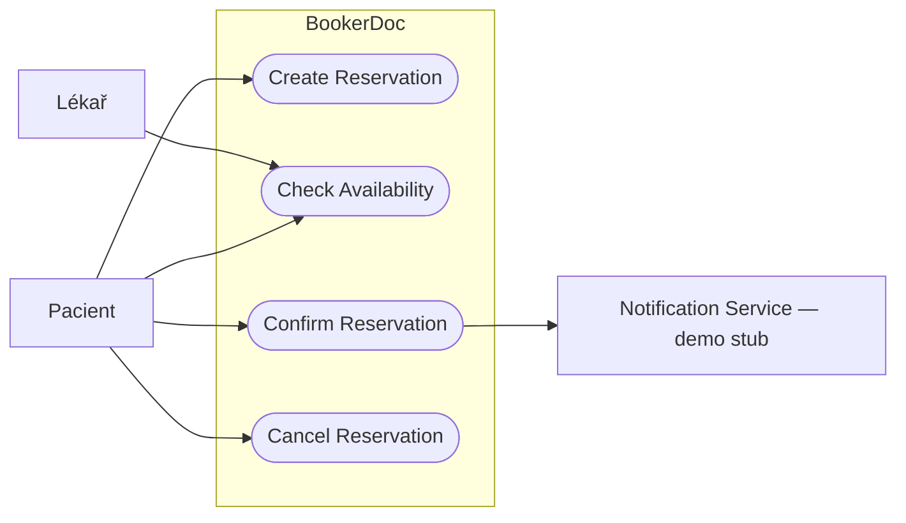
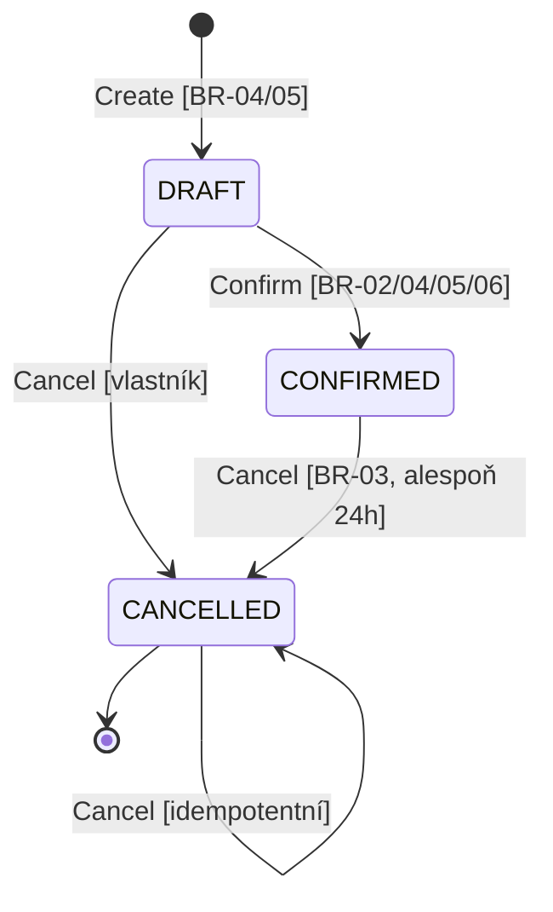
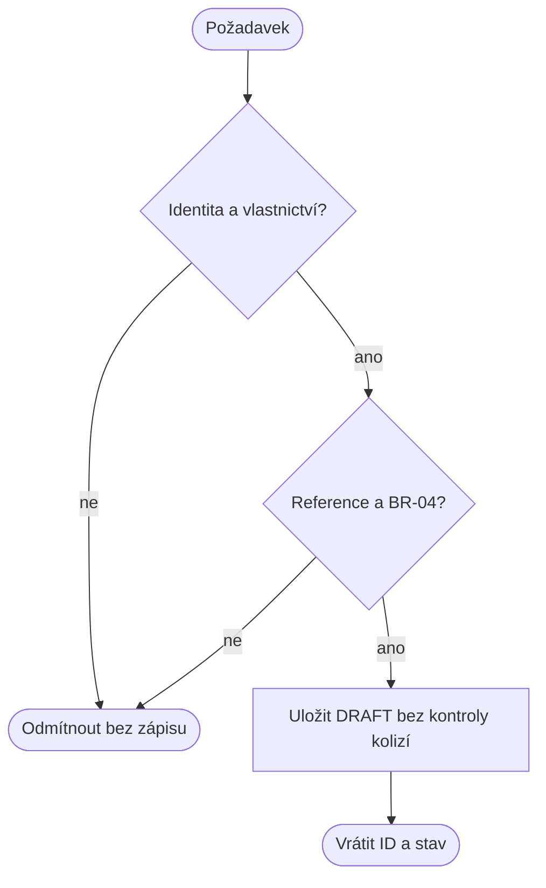
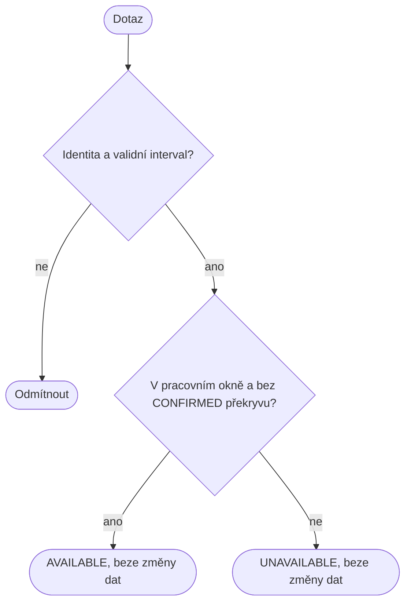
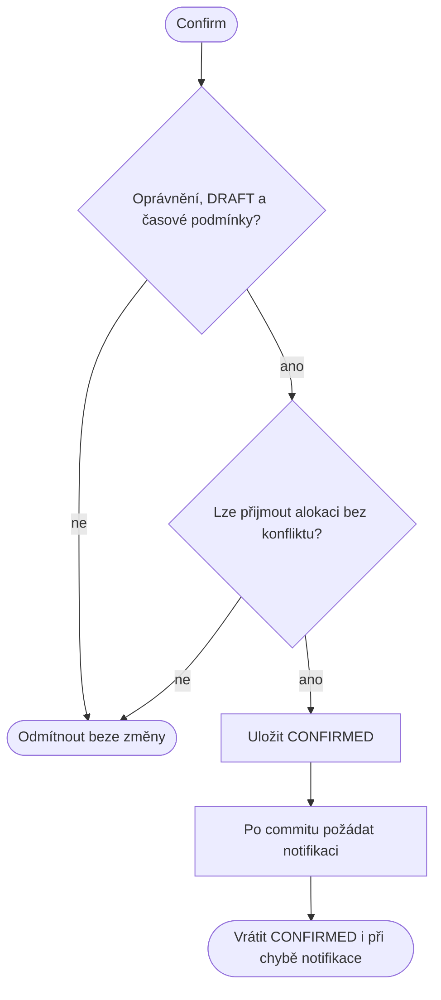
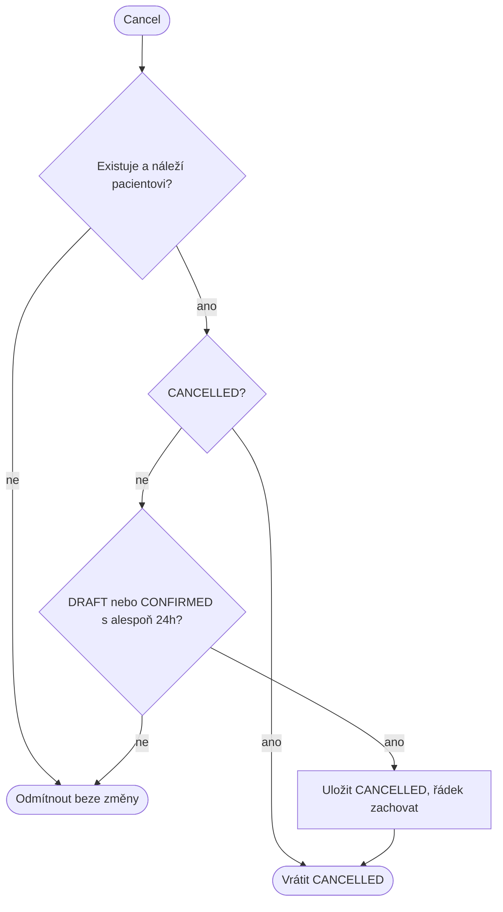

# Specification Baseline v0.1 — BookerDoc (C02)

## Stav a zdroje
Rozsah a následující politiky odsouhlasil zadavatel v konverzaci pokynem „udelej to proste oba PR“ dne 22. 9. 2026.
**Schválení celého týmu: čeká na explicitní review této baseline v PR.** Nepovažujeme autorství AI nebo úspěch testů za týmové schválení.
Zdroje: zadání C02, Project Frame C01, původní požadavek pacienta na automatické potvrzení a zrušení nejpozději 24 hodin před termínem.
Tento soubor je snapshot v0.1; změna schvalování bude mít samostatnou v0.2.

## Pojmy a hranice
Resource = lékař, Service = služba s délkou, Reservation = identita, pacient, lékař, služba, uložený začátek/konec/stav.
Pacient smí vytvářet, číst, potvrzovat a rušit své rezervace. Lékař může číst své rezervace a zjišťovat dostupnost.
Pro lokální demo se identita určuje bearer klíčem, který server mapuje na konkrétní roli a ID. ID v těle není oprávnění.
Registrace a produkční přihlašování jsou mimo rozsah. Oprávnění se však skutečně kontrolují a testují.
Běžné automatické objednání = Create a následně Confirm bez lidského schvalovatele; obě operace jsou samostatně předveditelné.
Původní POST z CP1, který rovnou potvrzoval, tímto vědomě nahrazujeme. Neúspěšné Confirm ponechá vytvořený návrh.

## Doménová pravidla — jediná normativní definice pro v0.1
- **BR-01 Interval:** [start,end), start < end. Časy jsou okamžiky ISO s offsetem/Z; vstup nanejvýš na milisekundy, začátky mají celé minuty. Navazující intervaly nekolidují.
- **BR-02 Exkluzivita:** v žádném commitnutém stavu se nesmějí překrývat dvě CONFIRMED stejného lékaře, bez ohledu na službu. DRAFT/CANCELLED neblokují. Availability nic nerezervuje.
- **BR-03 Rušení (současně vlastní pravidlo C01):** DRAFT lze zrušit kdykoliv, i po plánovaném začátku. CONFIRMED lze zrušit právě tehdy, když start − serverový čas ≥ 24 uplynulých hodin. CANCELLED se nemaže a opakované Cancel je úspěšné beze změny.
- **BR-04 Pracovní doba:** služba patří lékaři; délka 1–1440 celých uplynulých minut. Při Create se vypočte a uloží konec, pozdější změna délky služby ho nezmění. Při Create/Confirm je začátek budoucí, celý uložený interval leží v jednom pracovním okně Europe/Prague. Začátky jsou po 15 minutách od začátku okna. Intervalové Availability vrátí mimo okno false; neplatný formát nebo minulý začátek odmítne.
- **BR-05 Stav a oprávnění:** vytvoření → DRAFT; potvrzení pouze DRAFT → CONFIRMED; rušení podle BR-03. CANCELLED je koncový. Potvrzení jiného stavu se odmítne beze změny. Mutace pouze vlastníkem-pacientem; čtení vlastníkem-pacientem nebo příslušným lékařem. Availability mohou oba aktéři.
- **BR-06 Čas a souběh:** autoritativní je serverový čas vzorkovaný po získání práva měnit rezervaci. Confirm/Cancel stejné rezervace mají výsledek odpovídající jednomu sekvenčnímu pořadí. Cancel první → Confirm odmítnut; Confirm první → Cancel použije BR-03 pro CONFIRMED. Dva konfliktní Confirm → nejvýše jedno CONFIRMED; neúspěšná žádost zůstává DRAFT.
- **BR-07 Notifikace:** pouze úspěšný přechod do CONFIRMED vyvolá požadavek na notifikaci až po uložení. Chyba notifikace stav ani úspěch potvrzení nevrací. Demo používá stub, nikoli skutečné e-maily; doručení/retry není slibováno.

## OP-01 — Create Reservation
**Cíl / hodnota:** zaznamenat pacientův úmysl bez alokace času.
**Spouštěcí událost:** identifikovaný pacient odešle lékaře, službu a začátek.
**Pozorovatelné požadavky:** REQ-01: platný požadavek vytvoří právě jednu DRAFT s ID a vypočtenými časy; ani existující kolize nebrání vytvoření DRAFT.
**Předpoklady:** vlastní pacient, existující reference a platný interval podle BR-01/04/05.
**Stav po úspěchu:** DRAFT uložená, žádná notifikace ani alokace.
**Změna stavu:** [none] → DRAFT.
**Odkazy na pravidla:** BR-01, BR-02, BR-04, BR-05.
**Hlavní scénář:** 1. Ověřit identitu a vlastnictví. 2. Načíst reference a ověřit čas. 3. Uložit DRAFT. 4. Vrátit ID, stav, začátek a konec.
**Alternativy:** neznámá identita 401; jiný pacient/role 403; neznámá reference 404; neplatný vstup/čas/služba/okno 400. Nevznikne záznam.
**Ověření:** platný vstup → jedna DRAFT; kolidující platný vstup → další DRAFT; minulý čas → 400 a žádný nový řádek.
**Zdůvodnění / zdroj:** oddělení úmyslu od potvrzené alokace podle zadání C02; umožňuje nezávislé ověření Confirm.
**Předpoklad:** pacient i lékař jsou předem vložené demo identity.

## OP-02 — Check Availability
**Cíl / hodnota:** zjistit dostupnost lékaře pro konkrétní službu a začátek.
**Spouštěcí událost:** identifikovaný aktér dotáže interval odvozený z délky služby.
**Požadavky:** REQ-02: vrátit available=true právě pro interval vyhovující BR-04 bez kolize podle BR-02; neměnit rezervace.
**Předpoklady:** existující lékař a jeho služba, validní budoucí začátek.
**Stav po úspěchu:** výsledek a odvozené časy; žádná změna dat ani garance budoucího potvrzení.
**Změna stavu:** žádná.
**Pravidla:** BR-01, BR-02, BR-04, BR-05.
**Hlavní scénář:** 1. Ověřit aktéra a dotaz. 2. Odvodit interval. 3. Ověřit pracovní okno a blokující rezervace. 4. Vrátit výsledek bez zápisu.
**Alternativy:** 401 neidentifikovaný; 404 neznámé reference; 400 nevalidní vstup/minulost/nesouvisející služba. Mimo pracovní okno nebo kolize → úspěšný dotaz s false.
**Ověření:** CONFIRMED [10,11): [9,10) true, [10:30,11:30) false, [11,12) true za předpokladu pracovního okna. DRAFT nerozhoduje. Před/po dotazu stejné řádky.
**Zdůvodnění:** informativní dostupnost nesmí být zaměněna s držením termínu; aktuální souběh může výsledek okamžitě změnit.
**Předpoklad:** dotaz na jednotlivý interval stačí; seznam volných časů a UI nejsou pro C02 nutné.

## OP-03 — Confirm Reservation
**Cíl / hodnota:** přijmout existující návrh jako platnou alokaci lékaře.
**Spouštěcí událost:** pacient nebo jeho automatický tok požádá o potvrzení DRAFT.
**Požadavky:** REQ-03: oprávněnou DRAFT potvrdit pouze při splnění BR-04 a nepřekryvu BR-02. REQ-04: souběžné kolidující potvrzení může uspět nejvýše jedno.
**Předpoklady:** rezervace existuje a náleží pacientovi, zdrojový stav DRAFT.
**Stav po úspěchu:** CONFIRMED blokuje interval, ID i uložené časy zachovány; požadavek na notifikaci.
**Změna stavu:** DRAFT → CONFIRMED.
**Pravidla:** BR-01, BR-02, BR-04, BR-05, BR-06, BR-07.
**Hlavní scénář:** 1. Ověřit identitu a vlastnictví. 2. Posoudit aktuální stav/čas/podmínky. 3. Atomicky přijmout alokaci. 4. Po commitu požádat notifikaci. 5. Vrátit potvrzenou rezervaci.
**Alternativy:** 401/403/404; 409 nepovolený stav nebo kolize; 400 neplatné současné časové podmínky. Stav se nemění. Chyba notifikace → úspěch se zachovává, diagnostika bez obsahu e-mailu.
**Ověření:** volná DRAFT → CONFIRMED; kolidující → 409 a DRAFT; dvě konfliktní → právě jeden úspěch; opakování stejné potvrzené rezervace → 409 bez další notifikace.
**Zdůvodnění:** jediný okamžik alokace, invariant platí i při paralelní práci.
**Neznámá pro C03:** souběh budoucí editace pracovních oken s potvrzením; takové editační API v C02 není.

## OP-04 — Cancel Reservation
**Cíl / hodnota:** stáhnout rezervaci a uvolnit přidělený čas, se zachováním historie.
**Spouštěcí událost:** pacient požádá o zrušení existující vlastní rezervace.
**Požadavky:** REQ-05: podle BR-03 změnit na CANCELLED bez fyzického smazání; neplatné zrušení stav nezmění. REQ-06: souběh s Confirm odpovídá BR-06.
**Předpoklady:** existující vlastní rezervace; zdrojový stav a čas podle BR-03/05.
**Stav po úspěchu:** CANCELLED, termín neblokuje; při opakování stejný výsledek.
**Změna stavu:** DRAFT/CONFIRMED → CANCELLED; CANCELLED → CANCELLED beze změny.
**Pravidla:** BR-02, BR-03, BR-05, BR-06.
**Hlavní scénář:** 1. Ověřit identitu a vlastnictví. 2. Posoudit stav a aktuální čas. 3. Změnit pouze stav. 4. Vrátit uloženou rezervaci.
**Alternativy:** 401/403/404; pozdní zrušení CONFIRMED → 409 beze změny. Opakování CANCELLED → 200. Výsledky souběhu určuje BR-06.
**Ověření:** CONFIRMED přesně 24h před → CANCELLED; 24h minus 1ms → 409; DRAFT po začátku → CANCELLED; opakování → 200; Availability po zrušení true, pokud není jiná blokace.
**Zdůvodnění:** vlastní pravidlo C01 chrání čas ordinace, návrh ale žádný čas nedrží.
**Předpoklad:** pravidlo omezuje pacienta; zvláštní administrativní rušení není součástí baseline.

## Kontrola přijetí požadavků
Následující kontrola je připravená autorem k týmovému review, nikoli fingovaný záznam review jiného člena.

| REQ | Význam a potřeba | Pozorovatelný výsledek / porušení | Stav, čas, souběh | Proveditelnost a ověření |
|---|---|---|---|---|
| 01 | Zachytit úmysl bez alokace | DRAFT s ID; porušení = blokuje nebo už CONFIRMED | Create nemění dostupnost | Existující persistence; HTTP success + invalid create test |
| 02 | Informace bez držení | true/false, beze změn dat | [start,end), pouze CONFIRMED; snapshot | Dotaz na pracovní dobu a alokace; hraniční HTTP příklady |
| 03 | Přijmout platnou alokaci | CONFIRMED nebo odmítnutá nezměněná DRAFT | aktuální čas a okna; uložené časy | Přechod existujícího záznamu; success/conflict/state test |
| 04 | Zabránit dvojí alokaci | nejvýše jeden CONFIRMED | dvě paralelní žádosti | Invariant realizovatelný DB; skutečné souběžné HTTP testy |
| 05 | Uvolnit termín podle C01 | CANCELLED, zachované ID/řádek | přesně24h vs minus1ms; opakování | Injektovaný serverový čas v testech, klient ho nemůže nastavit |
| 06 | Jednoznačný závod operací | jeden z povolených sekvenčních výsledků | stejné ID Confirm/Cancel | Serializace mutací; souběžný test |

**Konzistence:** stejné BR odkazy v OP, diagramech i testech; DRAFT nikde neblokuje, alokace vzniká pouze Confirm a mizí Cancel.
**Požadavek versus implementace:** PostgreSQL, Prisma a zámky nejsou REQ, pouze současné řešení. Výše požadujeme pozorovatelné výsledky.
**Nejistoty:** model demo identity je záměrná hranice; reálné doručení e-mailu, UI, editace oken a produkční autentizace nejsou slibovány. Žádný nedořešený bod nemění základní přijímané chování.

## Diagram případů užití — aktéři, cíle a hranice systému

## Stavový diagram

## Aktivity OP-01

## Aktivity OP-02

## Aktivity OP-03

## Aktivity OP-04

