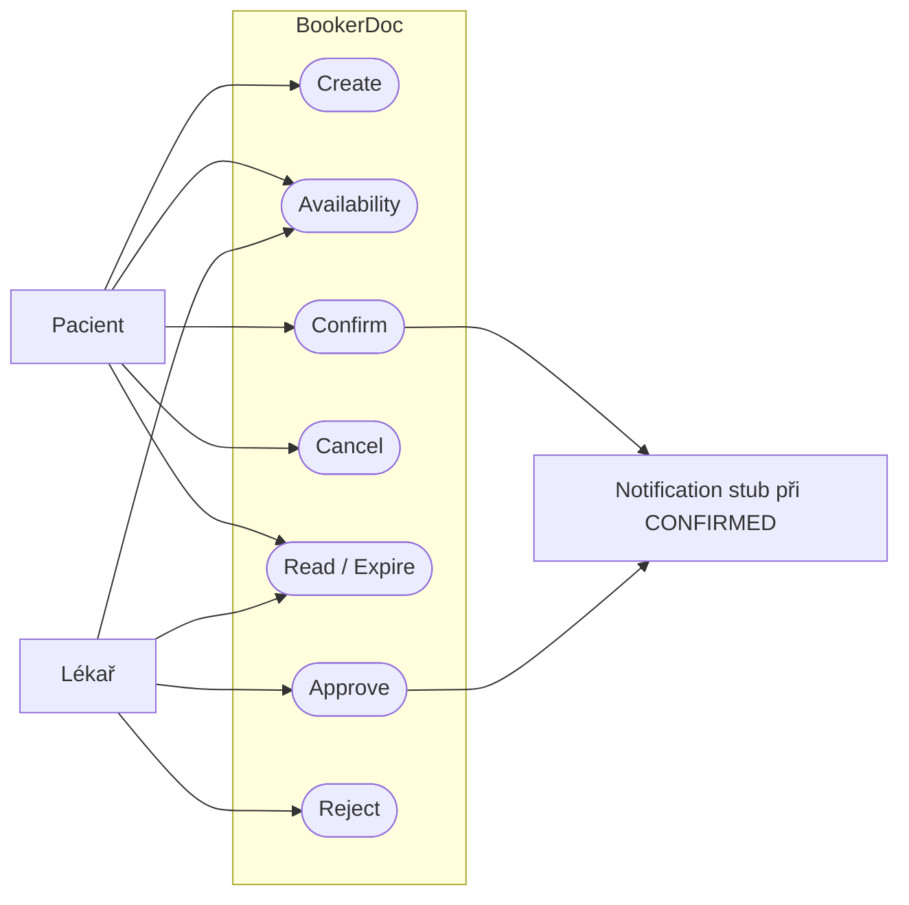
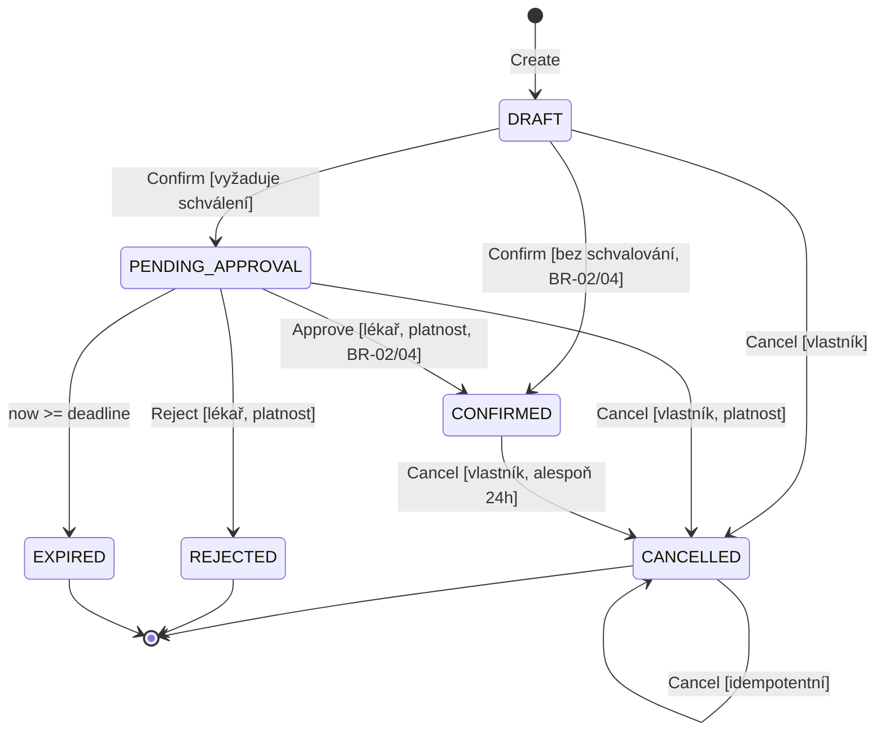
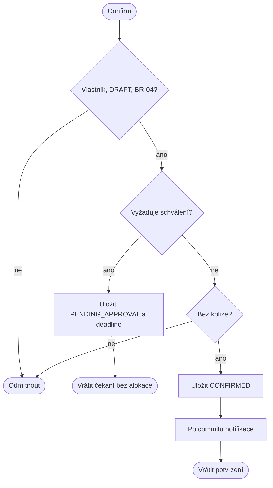
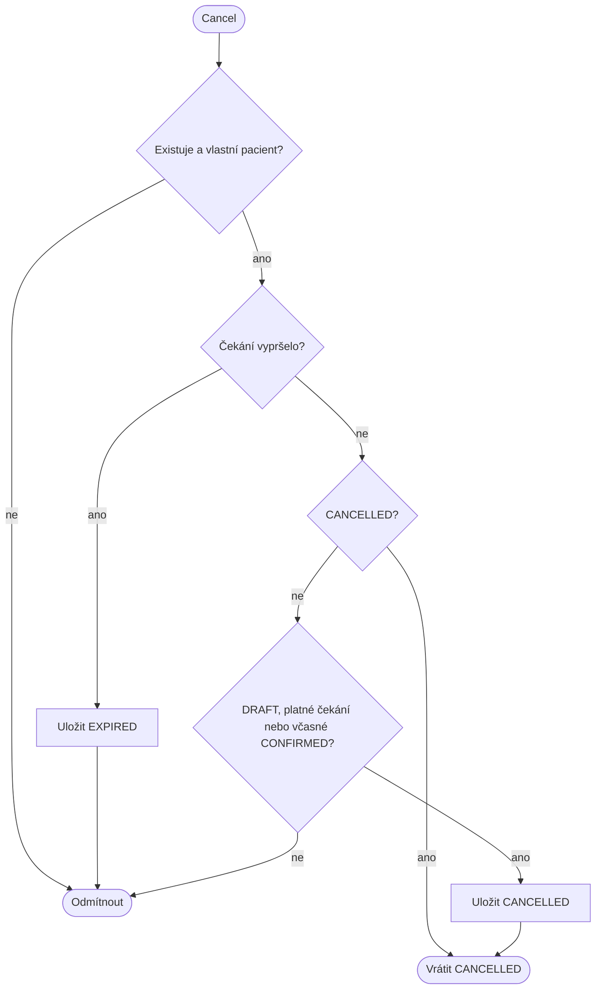
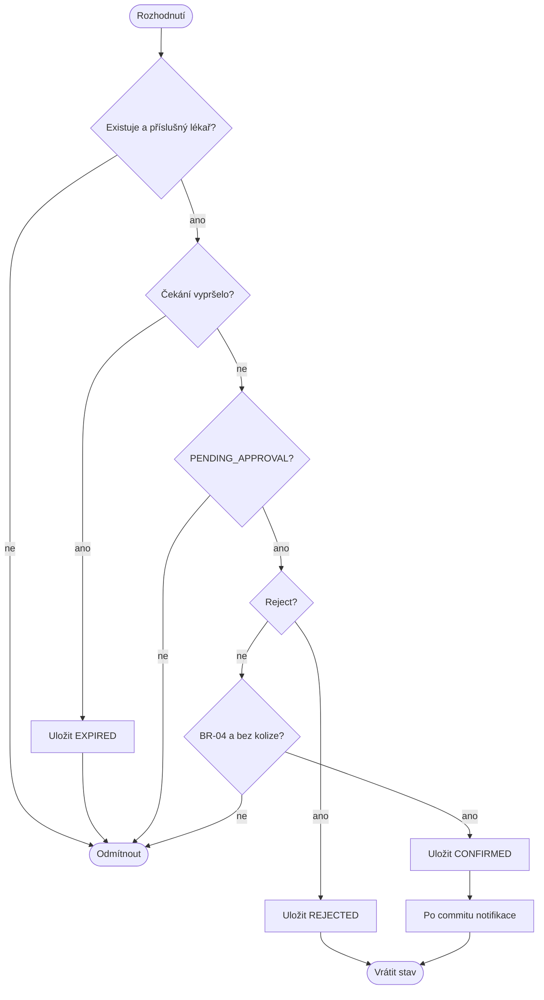
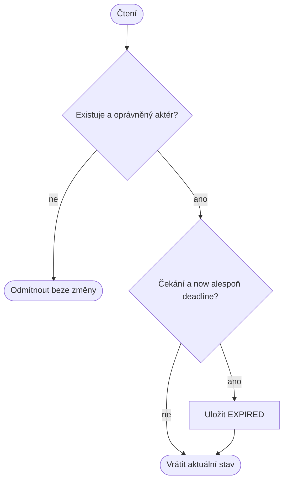

# Specification Baseline v0.2 — BookerDoc (C02)

## Stav, rozsah a návaznost

Výchozí [v0.1](v01.md) je neměnný historický snapshot `c02-v0.1`. Tato baseline jej rozšiřuje podle předem commitnuté [analýzy dopadu](v02-impact.md). Datum: 2026-09-22. Vlastník schválil realizaci obou návrhů; **schválení celého týmu je PENDING a musí být doloženo skutečným review PR**. Tag `c02-v0.2` označuje implementační snapshot, nikoli týmové schválení.

Resource je nadále lékař. Přidává se vlastnost `requiresApproval`; existující zdroje mají výchozí false. Lékař vlastnící zdroj může schválit nebo odmítnout žádost. Pacient je nemůže schvalovat. Produkční přihlášení a reálné doručování emailů zůstávají mimo demo rozsah.

## Centrální pravidla v0.2

Níže je úplný seznam pravidel aktuální baseline; OP odkazují na tato ID.

- **BR-01 — zachováno:** interval [start,end), celé minuty, ISO offset/Z s maximálně milisekundami; navazující intervaly nekolidují.
- **BR-02 — rozšířeno:** pouze CONFIRMED blokuje výlučného lékaře. DRAFT, PENDING_APPROVAL, CANCELLED, REJECTED a EXPIRED neblokují. Availability je informativní čtení bez rezervování kapacity. Dvě překrývající se CONFIRMED nesmějí být současně commitnuté.
- **BR-03 — rozšířeno:** pacient může kdykoliv zrušit DRAFT, platné PENDING_APPROVAL před deadline, CONFIRMED pouze při start − serverový čas ≥ 24 uplynulých hodin. CANCELLED je uchovaný a opakované Cancel uspěje beze změny. REJECTED/EXPIRED nelze zrušit ani oživit.
- **BR-04 — zachováno a aplikováno na Approve:** služba patří lékaři; délka 1–1440 celých uplynulých minut. Create uloží konec; pozdější změna délky jej nezmění. Create/Confirm/Approve vyžadují budoucí začátek a celý uložený interval v jednom současném pracovním okně Europe/Prague, začátek po 15 minutách od počátku okna. Availability odvozuje interval z aktuální služby, mimo okno vrací false, neplatný/minulý čas odmítá.
- **BR-05 — nahrazeno:** Create → DRAFT. Confirm pouze DRAFT: zdroj bez schvalování → CONFIRMED, se schvalováním → PENDING_APPROVAL. Approve pouze platné PENDING_APPROVAL → CONFIRMED, Reject → REJECTED. Create/Confirm/Cancel pouze vlastní pacient; Approve/Reject pouze příslušný lékař. Read pouze vlastní pacient či příslušný lékař; Availability oba. CANCELLED/REJECTED/EXPIRED jsou terminální; výjimkou je idempotentní Cancel již CANCELLED. Nepovolený přechod vrací 409.
- **BR-06 — rozšířeno:** stejná rezervace se mění v jednom sekvenčním pořadí; rozhodný čas je serverový, zjištěný po získání zámku. Conflicting Confirm/Approve smí potvrdit nejvýše jednu rezervaci. Konflikt zachová původní DRAFT/PENDING_APPROVAL. Approve proti Cancel: Cancel první znemožní Approve; Approve první podřídí Cancel hranici BR-03. Approve proti Reject: nejvýše jedna operace uspěje. Expirace má přednost, pokud čas při zpracování dosáhl deadline.
- **BR-07 — zachováno:** notifikace se požaduje pouze po úspěšném přechodu do CONFIRMED a commitu (Confirm či Approve). Selhání stav nevrací. PENDING_APPROVAL/REJECTED/EXPIRED/CANCELLED neposílají potvrzení; opakované Approve neduplikuje notifikaci. Demo používá stub bez garance doručení/retry.
- **BR-08 — nové, platnost žádosti:** při vstupu do PENDING_APPROVAL uložit requestedAt = serverový čas a expiresAt = min(requestedAt + 24 uplynulých hodin, startsAt). Žádost je platná pouze now < expiresAt. Při now >= expiresAt je logicky EXPIRED a žádná mutace ji nesmí schválit, odmítnout či zrušit. Autorizované Read materializuje a vrátí EXPIRED; autorizovaná mutace materializuje EXPIRED a vrátí 409 APPROVAL_EXPIRED. Další mutace již uloženého EXPIRED vrátí 409 INVALID_STATE. Bez interakce může DB uchovat PENDING_APPROVAL, jeho logická platnost však skončila. Restart lhůtu neobnoví. Neoprávněná operace stav nemění. Změna příznaku zdroje zpětně nepřepisuje již čekající žádost.

## Zachované operace

**OP-01 Create a REQ-01:** úplná šablona, scénář, chyby a ověření z [OP-01 v0.1](v01.md#op-01--create-reservation) platí beze změny. I pro zdroj se schvalováním vzniká DRAFT bez alokace a bez notifikace.

**OP-02 Availability a REQ-02:** úplná šablona z [OP-02 v0.1](v01.md#op-02--check-availability) zůstává, doplněno výslovné ignorování PENDING_APPROVAL/REJECTED/EXPIRED podle BR-02. Dotaz nic nematerializuje ani nemění. Úspěšná dostupnost nezaručuje úspěch pozdějšího Approve.

## OP-03 — Confirm Reservation (nahrazuje OP-03 v0.1)

**Cíl/hodnota:** dokončit pacientův návrh automatickým přijetím nebo předáním lékaři.
**Spouštěč:** pacient odešle Confirm vlastní DRAFT.
**Požadavky:** REQ-03 změněno: výsledek podle příznaku zdroje a BR-05; REQ-04 zachováno pro skutečnou alokaci. REQ-07 nové: čekající žádost má trvalý deadline, neblokuje a nevyvolá potvrzovací email.
**Předpoklady:** identifikovaný vlastník, existující DRAFT, BR-04.
**Stav po úspěchu:** stejná identita a časy; CONFIRMED nebo PENDING_APPROVAL s requestedAt/expiresAt.
**Změna stavu:** DRAFT → CONFIRMED / PENDING_APPROVAL.
**Pravidla:** BR-01/02/04/05/06/07/08.
**Scénář:** 1. Ověřit vlastníka. 2. Získat aktuální stav a čas. 3. Ověřit uložený interval. 4. Podle zdroje uložit žádost s deadline, nebo atomicky alokovat. 5. Pouze při alokaci po commitu požádat notifikaci. 6. Vrátit 200 a stav.
**Alternativy:** 401/403/404; 409 nepovolený stav nebo kolize automatického potvrzení; 400 neplatný čas/okno. Platný draft může přejít do čekání i přes obsazený termín. Neúspěch zachová stav, s výjimkou materializace již nastalé expirace podle BR-08.
**Ověření:** false → CONFIRMED; true → PENDING_APPROVAL, dostupnost stále true a žádný email; druhý Confirm → 409; kolizní automatické potvrzení → DRAFT.
**Zdroj/důvod:** změnové zadání C02 rozlišuje zdroje s a bez schválení; zachování automatického toku pro původní zdroje.
**Předpoklad:** příznak nastavuje demo seed či správce dat, editační API není součástí.

## OP-04 — Cancel Reservation (nahrazuje OP-04 v0.1)

**Cíl/hodnota:** stáhnout vlastní úmysl nebo uvolnit potvrzenou kapacitu s historií.
**Spouštěč:** pacient odešle Cancel.
**Požadavky:** REQ-05 rozšířeno o platnou čekající žádost; REQ-06 rozšířeno o závod s rozhodnutím lékaře a expirací.
**Předpoklady:** existující vlastní rezervace v povoleném stavu podle BR-03.
**Stav po úspěchu:** uchovaná CANCELLED bez blokace.
**Změna stavu:** DRAFT / platné PENDING_APPROVAL / včasné CONFIRMED → CANCELLED; CANCELLED → CANCELLED.
**Pravidla:** BR-02/03/05/06/08.
**Scénář:** 1. Ověřit vlastníka. 2. Posoudit aktuální čas a případnou expiraci. 3. Ověřit povolení podle stavu a BR-03. 4. Uložit CANCELLED a vrátit 200.
**Alternativy:** 401/403/404; pozdní CONFIRMED, REJECTED nebo EXPIRED → 409. Vypršení čekající žádosti se uchová i při odpovědi 409. Opakované CANCELLED → 200.
**Ověření:** platné čekání lze zrušit i hodinu před termínem; na deadline → 409 a EXPIRED; potvrzené přesně 24h ano, o 1ms později ne; Approve/Cancel odpovídá jednomu pořadí.
**Zdroj/důvod:** vlastní pravidlo C01 chrání již přidělený čas, čekání nic nedrží.
**Nejistota:** administrativní storno lékařem je mimo rozsah.

## OP-05 — Approve Reservation (nová úplná operace)

**Cíl/hodnota:** lékař přijme čekající žádost a závazně přidělí svůj čas.
**Spouštěč:** příslušný lékař odešle Approve s ID žádosti.
**Požadavky:** REQ-08: pouze příslušný lékař může platnou žádost potvrdit při splnění BR-02/04; REQ-04 platí i pro souběh schválení; REQ-09: zamítnutá kolize ponechá platnou žádost čekající.
**Předpoklady:** důvěryhodná identita lékaře, rezervace jeho zdroje, PENDING_APPROVAL a now < deadline, platný současný interval.
**Stav po úspěchu:** CONFIRMED, původní ID a časy, uchovaná metadata žádosti, blokující kapacita; notifikace po commitu.
**Změna stavu:** PENDING_APPROVAL → CONFIRMED.
**Pravidla:** BR-01/02/04/05/06/07/08.
**Scénář:** 1. Ověřit příslušného lékaře. 2. Serializovaně načíst stav a aktuální čas. 3. Ověřit platnost a pracovní interval. 4. Atomicky alokovat bez překryvu. 5. Po commitu požádat potvrzovací notifikaci. 6. Vrátit 200 CONFIRMED.
**Alternativy:** 401 bez identity; 403 pacient/jiný lékař; 404 chybějící rezervace; 409 jiný stav, vypršení či překryv; 400 již nevyhovující pracovní okno. Konflikt zachová PENDING_APPROVAL; vypršení uloží EXPIRED. Selhání notifikace zachová úspěch.
**Ověření:** příslušný lékař → CONFIRMED; pacient či jiný lékař → 403 beze změny; dvě konfliktní platné žádosti → jedna CONFIRMED a druhá PENDING_APPROVAL; opakování → 409 a právě jedna notifikace; přesný deadline → EXPIRED.
**Zdroj/důvod:** výslovně požadované lidské rozhodnutí pro vybrané zdroje; aktuální dostupnost se může od vytvoření žádosti změnit.
**Předpoklad/nejistota:** rozhodnutí se neprodlužuje, delegace lékaře není součástí; produkční role jsou tématem C03.

## OP-06 — Reject Reservation

**Cíl/hodnota:** lékař explicitně odmítne čekající žádost, pacient pozná konečný výsledek.
**Spouštěč:** příslušný lékař odešle Reject.
**Požadavek:** REQ-10: pouze příslušný lékař může platné čekání ukončit jako REJECTED bez alokace.
**Předpoklady:** existující vlastní zdroj, platné PENDING_APPROVAL.
**Stav po úspěchu / přechod:** PENDING_APPROVAL → uchované REJECTED, žádná notifikace potvrzení.
**Pravidla:** BR-02/05/06/07/08.
**Scénář:** ověřit aktéra → stav/čas → uložit REJECTED → 200.
**Alternativy:** 401/403/404; 409 neplatný stav či expirace; opakované Reject odmítnuto. Vypršení má přednost a materializuje EXPIRED.
**Ověření:** lékař odmítne platnou žádost, pacient ji přečte jako REJECTED; opakování a cizí aktér neuspějí; kapacita zůstane volná.
**Zdroj/důvod:** změnové zadání vyžaduje možnost odmítnutí.
**Předpoklad:** zdůvodnění odmítnutí a email odmítnutí nejsou požadované.

## OP-07 — Read / Expire

**Cíl/hodnota:** aktér vidí skutečnou aktuální platnost i po odložení rozhodnutí a restartu.
**Spouštěč:** autorizované čtení nebo mutace čekající žádosti po deadline.
**Požadavek:** REQ-11: od deadline API nevrátí platné čekání a neumožní rozhodnutí; vypršení trvale uchová při interakci.
**Předpoklady:** existující rezervace, oprávněný pacient/lékař pro Read nebo oprávněný aktér dané mutace.
**Stav po úspěchu / přechod:** nevypršelá rezervace beze změny; prošlé PENDING_APPROVAL → EXPIRED.
**Pravidla:** BR-05/06/08.
**Scénář:** oprávnění → serializovaný stav a serverový čas → porovnat deadline → případně uložit EXPIRED → Read vrátí 200 a stav; mutace po materializaci vrátí 409.
**Alternativy:** 401/403/404 bez změny; terminální stav se nemění. Absence časovače ani nový proces neprodlužují deadline.
**Ověření:** 1ms před deadline platné čekání; přesně na deadline Read EXPIRED; nový createApp nad stejnou DB zachová lhůtu; neúspěšná mutace expiraci nevrátí zpět.
**Zdroj/důvod:** změnové zadání vyžaduje vypršení; zvolená on-access materializace je dostatečná pro pozorovatelné chování.
**Nejistota:** hromadný reporting fyzických stavů a proaktivní expiry notifikace vyžadují další rozhodnutí C03.

## Akceptační kontrola a sledování změn

| REQ | Změna, smysl a potřeba | Pozorovatelný výsledek / porušení | Stav, čas, souběh | Proveditelnost a ověření |
| --- | --- | --- | --- | --- |
| 01 | beze změny: zaznamenat úmysl | DRAFT bez alokace | příznak nic nemění | původní integrační testy |
| 02 | upřesněno: čekání neblokuje | dostupnost před/po čekání stejná | pouze CONFIRMED | původní + pending test |
| 03 | změna: větvení potvrzení | CONFIRMED nebo PENDING_APPROVAL | příznak při Confirm | dva druhy zdroje v testech |
| 04 | rozšíření ochrany kapacity | nejvýše jedna alokace | Confirm i Approve, souběh | DB invariant + paralelní HTTP |
| 05 | rozšíření storna | CANCELLED nebo 409 | čekání vs 24h pro potvrzené | hraniční testy |
| 06 | rozšíření serializace | povolený sekvenční výsledek | Approve/Reject/Cancel/Expire | paralelní a řízené časové testy |
| 07 | nové: odložené rozhodnutí | deadline a čekání bez emailu | min(24h,start) | persistentní metadata + test |
| 08 | nové: oprávněné rozhodnutí | 200 vlastní lékař, 403 ostatní | pouze platné čekání | serverová identita + HTTP |
| 09 | nové: neztratit konfliktní žádost | 409 a PENDING_APPROVAL | souběh různých žádostí | transakční rollback + test |
| 10 | nové: konečné odmítnutí | REJECTED a nezměněná dostupnost | terminální, souběh | HTTP úspěch/opakování |
| 11 | nové: ukončit zastaralé čekání | EXPIRED od deadline | rovnost, restart, čekání na zámek | injektované hodiny + DB |

Konzistence: pouze přechod do CONFIRMED alokuje a notifikuje; všechny OP i diagramy používají stejné deadline a role. Volba DB a zámku je implementace, požadavkem je pozorovatelný výsledek. Tato autorská kontrola je podklad pro týmové review, nikoli jeho náhrada.

## Případy užití a hranice systému

## Životní cyklus

## Aktivity OP-01 a OP-02 — zachované
Diagramy OP-01 a OP-02 v [baseline v0.1](v01.md#aktivity-op-01) jsou nadále platné beze změny: Create ukládá DRAFT, Availability zkoumá pouze CONFIRMED.

## Aktivity OP-03 Confirm

## Aktivity OP-04 Cancel

## Aktivity OP-05 Approve a OP-06 Reject

## Aktivity OP-07 Read / Expire

