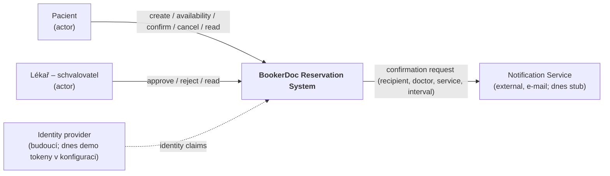
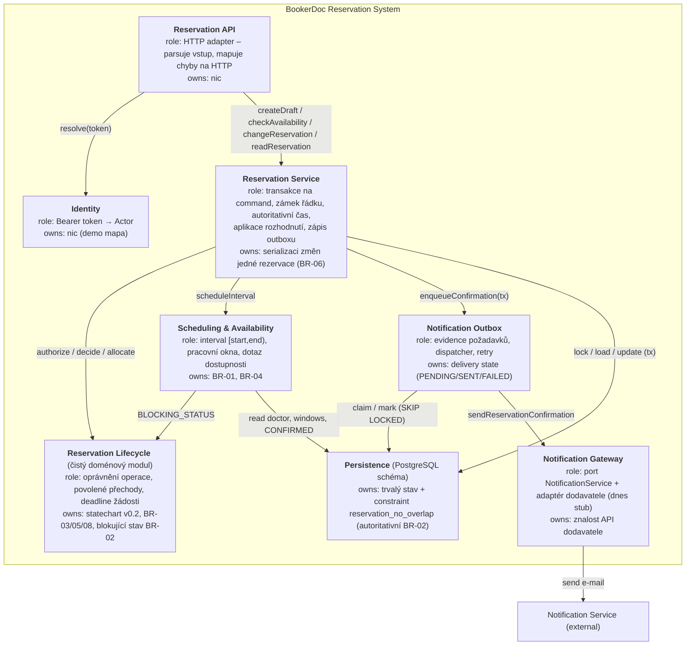
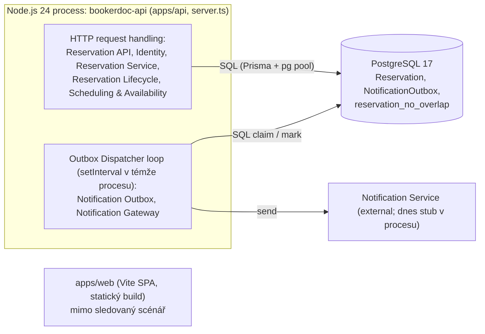
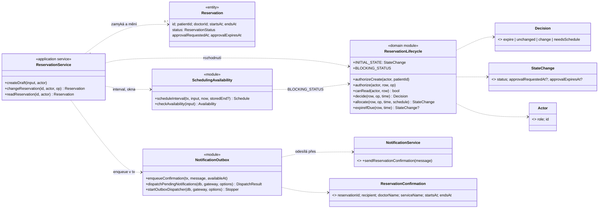

# C03 — Architektura BookerDoc: od AS-IS k přijaté TO-BE

Vstupy: [Specification Baseline v0.2](../c02/v02.md), drivery přenesené z C02
([evidence](../evidence-and-evolution.md#architektonické-drivery-přenesené-do-c03)) a
[Část A — AS-IS](../architecture-and-decisions.md#c03-část-a--as-is-realizace-scénáře-approve-reservation).
Sledovaný scénář: **Confirm → odložené Approve Reservation s potvrzovací notifikací** (OP-03, OP-05; BR-02/05/07/08).
Rozhodnutí: [ADR-006](../architecture-and-decisions.md#adr-006--doručení-potvrzovací-notifikace-transakční-outbox) a
[ADR-007](../architecture-and-decisions.md#adr-007--jediný-vlastník-přechodů-životního-cyklu-reservation).

## B. Architektonické drivery

| # | Podklad / zdroj | Proč ovlivňuje architekturu | Otázka, kterou musí architektura vyřešit |
|---|---|---|---|
| D1 | BR-02, REQ-04, REQ-09; Část A3 (constraint `reservation_no_overlap`) | dva souběžné Confirm/Approve mohou oba vidět „bez konfliktu“; dvě platné žádosti smějí čekat na stejný termín | kde se dělá autoritativní rozhodnutí o alokaci, aby BR-02 platilo i při souběhu? |
| D2 | BR-08, REQ-07, REQ-11; C02 driver 1 | žádost o schválení přežívá konec původního requestu i restart procesu; rozhoduje jiný aktér v jiném requestu | kdo vlastní stav čekající žádosti a jeho deadline a kdo provede pozdější přechod? |
| D3 | BR-07, ADR-004; Část A3 (`app.ts:43-46`); C02 driver 5 | změna stavu se commitne dříve než notifikace; poskytovatel může selhat nebo proces spadnout | má selhání notifikace měnit výsledek potvrzení, kde je požadavek na notifikaci trvale evidován a kdo řeší retry? |
| D4 | statechart v0.2; Část A5 (6 zápisů status literálů, duplicitní expirace) | každá kopie pravidla přechodu může se statechartem divergovat; změna C02 (approval) zasáhla všechny kopie | kde se rozhoduje o přechodu stavu, aby statechart měl v kódu právě jednoho vlastníka? |

Drivery neurčují řešení. Transakce, outbox, worker, constraint apod. jsou mechanismy porovnávané níže.

## C1. Doménový model (výřez pro scénář)

```mermaid
classDiagram
  direction LR
  class Patient { email }
  class Doctor { name; requiresApproval }
  class Service { name; durationMinutes }
  class WorkingWindow { weekday; startMinute; endMinute }
  class Reservation { status }
  class TimeInterval { <<value object>> start; end  «[start,end)» }
  class ApprovalRequest { <<value object>> requestedAt; expiresAt }
  class ConfirmationNotification { recipient; deliveryState }
  Patient "1" -- "0..*" Reservation : vlastní
  Doctor "1" -- "0..*" Reservation : je Resource pro
  Service "1" -- "0..*" Reservation : typ
  Doctor "1" -- "1..*" Service : nabízí
  Doctor "1" -- "0..*" WorkingWindow : pracuje v
  Reservation "1" *-- "1" TimeInterval : interval
  Reservation "1" *-- "0..1" ApprovalRequest : pouze pokud Doctor.requiresApproval
  Reservation "1" -- "0..1" ConfirmationNotification : vznikne při přechodu do CONFIRMED
```

Invarianty na vztazích: **BR-02** — pro jednoho `Doctor` se intervaly jeho `Reservation` ve stavu CONFIRMED nepřekrývají;
**BR-08** — `ApprovalRequest.expiresAt = min(requestedAt + 24 h, interval.start)`; **BR-07** — nejvýše jedna
`ConfirmationNotification` na Reservation. `ApprovalRequest` je součást Reservation (ne samostatná entita), protože
nemá vlastní identitu ani životní cyklus nezávislý na Reservation.

## C2. Odpovědnosti systému

| # | Zdroj | Odpovědnost | Co musí rozhodovat / vlastnit | Jeden jasný vlastník? | Důvod |
|---|---|---|---|---|---|
| R1 | OP-03/05, statechart | rozhodnout, zda je přechod stavu povolený a do jakého stavu | lifecycle transition | ano | různé části nesmí rozhodnout odlišně (D4) |
| R2 | BR-05 | ověřit, že aktér smí operaci provést | vztah aktér ↔ pacient/lékař rezervace | ano | stejná operace nesmí mít dvě autorizační pravidla |
| R3 | BR-08 | spravovat čekající žádost a její deadline, materializovat EXPIRED | approval request state | ano | stav přežívá request (D2) |
| R4 | BR-02, REQ-04 | vyhodnotit konflikt a zachovat exkluzivitu | autoritativní alokace při souběhu | ano | souběh nesmí porušit invariant (D1) |
| R5 | BR-01, BR-04 | spočítat interval a ověřit pracovní okno | výpočet intervalu, pracovní okna | ano | stejná validace pro Create, Availability, Confirm i Approve |
| R6 | BR-06 | serializovat změny jedné rezervace a vzorkovat autoritativní čas | zámek řádku, transakce | ano | výsledek musí odpovídat jednomu sekvenčnímu pořadí |
| R7 | BR-07, ADR-004 | trvale evidovat požadavek na notifikaci a doručit ho s opakováním | delivery state, retry | ano | externí selhání nesmí být nejasné ani ztratit zprávu (D3) |
| R8 | ADR-004 | znát technické API poskytovatele e-mailu | integrace dodavatele | ano | výměna dodavatele nesmí zasáhnout rezervační logiku |

Seskupení a oddělení:

| Odpovědnost | Seskupit s (sdílený stav / invariant) | Oddělit od (jiný důvod změny / boundary) |
|---|---|---|
| R1 přechody | R2, R3 — všechny čtou a mění `Reservation.status` podle statechartu | R4 (DB mechanismus), R7/R8 (externí failure), HTTP |
| R2 oprávnění | R1 — pravidlo je součástí povoleného přechodu | identita/tokeny (mění se se zavedením IdP) |
| R3 čekající žádost | R1 — deadline je stav Reservation | časovač/job (zatím neexistuje, on-access materializace) |
| R4 alokace | R6 — musí proběhnout v téže transakci jako změna stavu | R5 (čistý výpočet), R7 |
| R5 interval/okna | — čistá doménová validace | perzistence a HTTP |
| R6 transakce/čas | R4, zápis outboxu R7 (musí být atomický se změnou stavu) | rozhodovací pravidla R1 (ta mají být bez I/O) |
| R7 doručení | trvalý záznam musí vzniknout ve stejné transakci jako CONFIRMED | R8 (technologie dodavatele), HTTP request |
| R8 dodavatel | — | vše ostatní (trust boundary, jiný důvod změny) |

## D. Hlavní rozhodovací otázka

**Kde a jak má být zajištěno doručení potvrzovací notifikace po Confirm/Approve tak, aby její selhání nezměnilo
výsledek potvrzení a požadavek na notifikaci se neztratil?** (driver D3; dotýká se D2, protože Approve přichází
v jiném requestu, a D1, protože notifikace smí vzniknout jen pro skutečně commitnutou alokaci.)

## E1. Dvě materiálně odlišné alternativy

**Alternativa A — synchronní best-effort volání v aplikační službě po commitu** (přesun z HTTP vrstvy):

```text
[Reservation API] --command--> [Reservation Service] --tx--> [PostgreSQL]
                                        |  po commitu: send(message), chyba → log
                                        v
                               [Notification Gateway] ---> [Notification Service]
```

**Alternativa B — transakční outbox + dispatcher** (záznam ve stejné DB transakci, doručení samostatnou runtime aktivitou):

```text
[Reservation API] --command--> [Reservation Service] --tx: status=CONFIRMED + INSERT outbox--> [PostgreSQL]
                                                                                                   ^
[Outbox Dispatcher] --claim PENDING (SKIP LOCKED) / mark SENT|retry-------------------------------+
        |  send(message)
        v
[Notification Gateway] ---> [Notification Service]
```

(Zvažována a zamítnuta byla i varianta „externí message broker“: v systému s jednou DB a jedním procesem přidává
infrastrukturu, ale stále potřebuje outbox, aby zápis do brokeru byl atomický se změnou stavu.)

## E2. Porovnání vůči driverům

| Driver / kritérium | Alternativa A — synchronní po commitu | Alternativa B — transakční outbox |
|---|---|---|
| D3 konzistence stav ↔ notifikace | mezi commitem a odesláním neexistuje trvalý záznam; pád procesu nebo výpadek dodavatele zprávu ztratí bez stopy | požadavek vzniká v téže transakci jako CONFIRMED: buď existují oba, nebo žádný (rollback při kolizi BR-02 smaže i outbox řádek) |
| D3 failure behaviour | chyba se jen zaloguje, žádný retry; volající dostane 200, ale pacient e-mail nikdy nedostane | chyba zvýší `attempts` a naplánuje retry s backoffem; po vyčerpání pokusů stav `FAILED` viditelný v DB pro obsluhu |
| D2 odložené schválení | notifikace závisí na tom, že request lékaře doběhne až po odeslání; latence dodavatele prodlužuje odpověď Approve | Approve odpoví hned po commitu; doručení nezávisí na životnosti requestu ani procesu (restart pokračuje z DB) |
| D1 souběh / duplicity | dva souběžné Approve stejné rezervace: řeší zámek, notifikace max. jednou | navíc `UNIQUE(reservationId, kind)` brání duplicitnímu požadavku; dva dispatchery si řádky dělí přes `FOR UPDATE SKIP LOCKED`; doručení je **at-least-once** (při pádu po odeslání, před označením SENT, může dojít k opakování) |
| změna / ownership | odpovědnost za doručení nemá trvalý stav, nikdo ji nevlastní | Notification Outbox vlastní delivery state; dodavatele zná jen Notification Gateway |
| provozní složitost | žádná nová tabulka ani smyčka | nová tabulka + migrace, polling smyčka v procesu, parametry retry (provizorní hodnoty), monitorování `FAILED` |

## E3. Průchod scénářem: Confirm → Approve, dodavatel e-mailu je nedostupný

| Krok / událost | Alternativa A | Alternativa B |
|---|---|---|
| Confirm Reservation začne (pacient) | Service zamkne řádek, Lifecycle rozhodne DRAFT → PENDING_APPROVAL, commit | totéž; žádný outbox řádek (BR-07: čekání nevyvolá notifikaci) |
| je potřeba approval | deadline uložen v Reservation (BR-08) | totéž |
| proces/request skončí | stav je jen v DB; nic dalšího neběží | stav je jen v DB; dispatcher nemá co odeslat |
| approval přijde později (lékař, jiný request, klidně po restartu) | Service zamkne řádek, Lifecycle ověří deadline, UPDATE CONFIRMED, commit; potom volá dodavatele | Service zamkne řádek, Lifecycle ověří deadline, UPDATE CONFIRMED **+ INSERT outbox** v jedné transakci, commit, 200 |
| dodavatel je nedostupný / proces spadne po commitu | výjimka se zaloguje (nebo se při pádu nestane nic); rezervace CONFIRMED, **pacient se to nikdy nedozví** | dispatcher: pokus 1 selže → `attempts=1`, `nextAttemptAt` posunut; po obnově dodavatele (i po restartu) další běh odešle a označí `SENT` |
| souběžné kolidující Approve | constraint pustí jedno CONFIRMED; druhý rollback, žádná notifikace | totéž; rollback druhé transakce odstraní i její outbox INSERT → právě jeden požadavek |

Obě alternativy realizují pozorovatelné chování v0.2 (BR-07 neslibuje doručení). Liší se v tom, co se stane
se zprávou po selhání: A ji ztratí, B ji doručí později nebo ji viditelně označí jako `FAILED`.

## F. ADR

Viz [ADR-006](../architecture-and-decisions.md#adr-006--doručení-potvrzovací-notifikace-transakční-outbox)
(rozhodnutí: **B — transakční outbox**) a doplňkové
[ADR-007](../architecture-and-decisions.md#adr-007--jediný-vlastník-přechodů-životního-cyklu-reservation)
(driver D4: jediný vlastník přechodů).

## G1. Kontext systému



## G2. TO-BE statická architektura



Zakázané závislosti (ověřuje L2): Reservation API → Notification Gateway/Outbox; Reservation Service →
Notification Gateway; Reservation Lifecycle → jakékoli I/O (Prisma runtime, Express). ADR-006 je vidět jako
prvek **Notification Outbox** mezi službou a gateway; ADR-007 jako samostatný prvek **Reservation Lifecycle**.

Mapování na kód (TO-BE): API = `src/app.ts`; Identity = `src/actors.ts`; Reservation Service =
`src/reservations/reservation-service.ts`; Lifecycle = `src/reservations/lifecycle.ts`; Scheduling & Availability =
`src/reservations/availability.ts` + `scheduling.ts`; Outbox = `src/notifications/outbox.ts`; Gateway =
`src/notifications/notification-service.ts` + `notification-stub.ts`; Persistence = `prisma/schema.prisma` + migrace.

## G3. Vlastnictví přechodů ve statechartu

Statechart v0.2 se nemění (stejné stavy i přechody); doplňujeme vlastníka rozhodnutí.

| Přechod | Owner rozhodnutí | Kdo může transition pouze vyžádat |
|---|---|---|
| [*] → DRAFT | Reservation Lifecycle (`INITIAL_STATE`) po validaci Scheduling | Pacient přes Reservation API |
| DRAFT → PENDING_APPROVAL | Reservation Lifecycle (`allocate`, podle `requiresApproval`) | Pacient |
| DRAFT → CONFIRMED | Reservation Lifecycle (`allocate`); kolizi autoritativně Persistence constraint | Pacient |
| PENDING_APPROVAL → CONFIRMED | Reservation Lifecycle (`decide` + `allocate`); kolizi Persistence constraint | Lékař daného zdroje |
| PENDING_APPROVAL → REJECTED | Reservation Lifecycle (`decide`) | Lékař daného zdroje |
| PENDING_APPROVAL → CANCELLED, DRAFT/CONFIRMED → CANCELLED | Reservation Lifecycle (`decide`, BR-03) | Pacient |
| PENDING_APPROVAL → EXPIRED | Reservation Lifecycle (`decide` / `expireIfDue`, BR-08); materializuje Reservation Service při autorizované interakci | nikdo — časová událost |
| Outbox PENDING → SENT / PENDING (retry) / FAILED | Notification Outbox (dispatcher) | nikdo — vzniká jen jako důsledek přechodu do CONFIRMED |

## G4. Runtime / deployment mapping



Jeden deployable. Dispatcher je samostatná runtime aktivita ve stejném procesu, takže ho lze později přesunout do
vlastního procesu beze změny kódu modulu (`startOutboxDispatcher` se jen zavolá z jiného entrypointu).

## H1. Návrhový sekvenční diagram — Approve s větví kolize

```mermaid
sequenceDiagram
  actor L as Lékař
  participant API as Reservation API
  participant SVC as Reservation Service
  participant LC as Reservation Lifecycle
  participant AV as Scheduling & Availability
  participant OB as Notification Outbox
  participant DB as Persistence (PostgreSQL)
  participant GW as Notification Gateway
  L->>API: POST /reservations/{id}/approve
  API->>SVC: changeReservation(id, actor, "approve")
  SVC->>DB: BEGIN; SELECT … FOR UPDATE
  SVC->>LC: authorize(actor, row, "approve")
  SVC->>LC: decide(row, "approve", now)
  LC-->>SVC: needsSchedule (PENDING_APPROVAL, now < expiresAt)
  SVC->>AV: scheduleInterval(row, now)
  AV-->>SVC: fits, requiresApproval, doctor, service
  SVC->>LC: allocate(row, "approve", now, schedule)
  LC-->>SVC: StateChange{status: CONFIRMED}
  SVC->>DB: UPDATE Reservation SET status = CONFIRMED
  alt bez kolize
    SVC->>OB: enqueueConfirmation(tx, message, now)
    OB->>DB: INSERT NotificationOutbox (PENDING)
    SVC->>DB: COMMIT
    SVC-->>API: Reservation CONFIRMED
    API-->>L: 200 CONFIRMED
  else kolize – reservation_no_overlap (BR-02)
    DB-->>SVC: P2039 exclusion violation
    SVC->>DB: ROLLBACK (stav zůstává PENDING_APPROVAL, žádný outbox)
    SVC-->>API: ReservationError 409 RESERVATION_CONFLICT
    API-->>L: 409
  end
  Note over OB,GW: později, asynchronně (Outbox Dispatcher)
  OB->>DB: UPDATE … attempts+1 WHERE id IN (SELECT … FOR UPDATE SKIP LOCKED) RETURNING
  OB->>GW: sendReservationConfirmation(message)
  alt doručeno
    OB->>DB: status = SENT
  else selhání dodavatele
    OB->>DB: nextAttemptAt += backoff (PENDING) nebo FAILED po max. pokusech
  end
```

## H2. Zaměřený návrhový třídní diagram



Každá zpráva z H1 má vlastníka v H2: `changeReservation` → ReservationService; `authorize/decide/allocate` →
ReservationLifecycle; `scheduleInterval` → SchedulingAvailability; `enqueueConfirmation`/dispatch →
NotificationOutbox; `sendReservationConfirmation` → NotificationService.

## I. Cross-view kontrola (provedena před změnou kódu)

| Kontrola | Výsledek | Nalezený rozpor → oprava |
|---|---|---|
| C02 ↔ G2 | všechny operace v0.2 mají vlastníka; BR-07 je splněno silněji (požadavek trvalý, doručení stále bez SLA) | v0.2 se nemění — outbox nemění pozorovatelný kontrakt API |
| C2 ↔ G2 | R1–R3 → Lifecycle, R4 → Persistence + Service, R5 → Scheduling, R6 → Service, R7 → Outbox, R8 → Gateway | AS-IS má část R2 (`requirePatient`) v Identity (`actors.ts`), ostatní oprávnění inline v `create.ts` → dva vlastníci. TO-BE: celé R2 v Lifecycle (`authorize`, `authorizeCreate`, `canRead`); Identity jen překládá token |
| C2 ↔ G2 (BR-02) | Availability musí vědět, které stavy blokují | AS-IS duplikuje literál `CONFIRMED` (Část A5) → v G2 přidána závislost Scheduling & Availability → Lifecycle (`BLOCKING_STATUS`) |
| G2 ↔ H1 | všechny šipky v sekvenci existují v G2; Service nevolá Gateway | — |
| H1 ↔ H2 | každá zpráva má vlastníka (seznam pod H2) | — |
| statechart ↔ G3/H1 | všechny přechody rozhoduje Lifecycle; EXPIRED je časová událost bez žadatele | statechart v0.2 nemá stavy doručení — správně, jsou to stavy jiného prvku (Outbox, G3 poslední řádek), ne stavy Reservation |
| G2 ↔ G4 | každý prvek je v procesu `bookerdoc-api`; Persistence v PostgreSQL | Outbox potřebuje aktivitu, která neběží v HTTP requestu → v G4 explicitně Outbox Dispatcher loop a jeho start/stop v `server.ts` |
| ADR ↔ G2/G4 | ADR-006 = Outbox + Dispatcher (G2, G4); ADR-007 = Lifecycle (G2, G3) | — |

## J. AS-IS → TO-BE delta

| Oblast | AS-IS (Část A) | TO-BE | Akce |
|---|---|---|---|
| odeslání notifikace | `app.ts` volá dodavatele po commitu, chyba → log | `app.ts` o notifikacích neví; Service zapíše outbox v transakci, Dispatcher doručuje s retry | **CHANGE** |
| evidence požadavků na notifikaci | neexistuje | tabulka `NotificationOutbox` (`PENDING/SENT/FAILED`, `attempts`, `nextAttemptAt`, `UNIQUE(reservationId, kind)`) | **CHANGE** (migrace) |
| rozhodování o přechodech | inline v `changeReservation` + kopie expirace v `readReservation` | čistý modul `lifecycle.ts`; Service jen aplikuje `StateChange` | **CHANGE** |
| zápis status literálů | 6 míst v `create.ts` + `checkAvailability` | pouze `lifecycle.ts` (`INITIAL_STATE`, `BLOCKING_STATUS`, `StateChange`) | **CHANGE** |
| výpočet intervalu / dostupnost | v `create.ts` | `availability.ts` (Scheduling & Availability) | **CHANGE** (přesun) |
| BR-02 při souběhu | DB exclusion constraint + mapování P2039 | stejné | **KEEP** |
| serializace změn jedné rezervace | `SELECT … FOR UPDATE`, čas po zámku | stejné, v Reservation Service | **KEEP** |
| identita | demo tokeny v `actors.ts` | stejné (IdP mimo rozsah) | **KEEP** |
| oprávnění (BR-05) | `requirePatient` v `actors.ts` + inline podmínky v `create.ts` | `lifecycle.ts` (`authorize`, `authorizeCreate`, `canRead`) | **CHANGE** |
| HTTP kontrakt API | 4 mutace + read + availability | beze změny | **VERIFY** (C02 testy) |
| směry závislostí | neověřeno | jen povolené směry z G2 | **VERIFY** (L2 test) |
